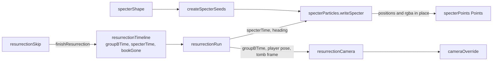

# Design: Graveyard of Ideas core

## Overview
Layered architecture: a pure domain core, a persisted store, and a rendering layer that only reads state. Animations are orchestrated by a small state machine.

## Data model (src/domain)
```ts
type Status = 'resting' | 'resurrected' | 'accomplished';
interface HistoryEntry { at: string; kind: 'created'|'buried'|'resurrected'|'rested'|'honored'|'action-done'|'note'; text?: string }
interface Project {
  id: string; title: string; description: string;
  goal?: string; abandonReason?: string; epitaph?: string;
  notes: string; links: string[];
  status: Status;
  slot?: number;               // only when resting
  reducedVersion?: string; nextAction?: string;
  result?: string; resultLink?: string;
  history: HistoryEntry[];
  createdAt: string; updatedAt: string; buriedAt?: string; resurrectedAt?: string;
}
interface AppData { schemaVersion: number; projects: Project[]; seeded: boolean; prefs: { quality: 'low'|'medium'|'high'; reducedMotion: boolean } }
```

## Domain functions (pure, tested)
`buryNewProject(input, projects, opts?)` — the single entry point for creation. Validates (title and description required, non-empty after trimming), allocates a free slot, and builds a resting project atomically. Returns `{ ok: true, project, projects }` or `{ ok: false, error: 'invalid_title' | 'invalid_description' | 'graveyard_full' }`. Input is never persisted on failure. The `opts` parameter accepts `{ now?, id? }` for deterministic testing.

`rebury(project, projects, opts?)` — re-assigns a slot to an existing project (used by `restAgain`). Pure, no mutation.

`resurrect`, `restAgain`, `honor`, `remove`, `allocateSlot`, `exportData`, `importData` (validate + migrate) — implemented in later tasks.

`ritualSteps.ts` (new, pure, in `src/domain`) holds the field list of the burial ritual and the per-step validators; see "Burial ritual". `buryNewProject` stays the only way a project is created and remains the final authority: the step validators never accept something `buryNewProject` would refuse, except `graveyard_full`.

Invariants: a project exists exactly once; a slot is used by at most one resting project; **every resting project must have a slot** (enforced by `buryNewProject` — no slotless resting project can be created); resurrect never duplicates.

## Grave slots
A fixed list of slot positions on the terrain (e.g. 12). Tombs are rendered from resting projects by slot. Tomb shapes vary by slot (rounded, rectangular, worn) chosen deterministically.

## UI state machine (src/interaction)
exploring -> openingGrave -> reading -> closingGrave -> exploring
exploring -> burying -> exploring        (the burial ritual: pages, then the burial cinematic; see "Burial ritual")
entrance -> exploring (finished or skipped); exploring/paused -> entrance (replay from the menu); see "Haunted experience layer", section C
reading -> resurrecting -> exploring
any -> paused -> previous
A transition is rejected while a cinematic is running (guard). Skip jumps to the sequence's final step and calls cleanup.

For books, `openingGrave`, `reading` and `closingGrave` are not stored separately: they are derived from the phase of the book reading machine (see "Book interaction (task 5.3)"). In that design `openingGrave` means the book lifts, approaches and opens its cover; there is no slab animation.

`burying` is derived the same way: it is true exactly while the ritual machine phase is not `idle` (pages and cinematic together). Burying starts only from `exploring`, so it cannot start while a book is open, and a book cannot open while it runs.

## Player controller (src/interaction)
Keyboard: ZQSD, WASD and arrows, Shift to sprint. Typing targets are ignored; held keys are released on blur, tab hide and whenever walking is disabled. Walk speed 2.0 units/s, sprint 3.2 units/s (separate constants), frame delta clamped, bounds and box collisions with sliding.

Look is direct, with no smoothing, acceleration or dead zone. The pure `applyLook(look, movementX, movementY, sensitivity)` in `playerLook.ts` is applied once per mouse event: yaw and pitch change by delta times sensitivity, pitch is clamped to +/-75 degrees, and an axis whose delta exceeds 200 px is ignored (browser glitch filter). Sensitivity defaults to 0.0022 rad/pixel and is persisted under its own localStorage key by `store/lookSensitivity.ts` (safe read and write, stored value validated to 0.0003..0.02, default on any invalid value). A settings screen can write it later with `saveLookSensitivity`.

Pointer Lock is the default. `pointerLock.ts` holds a small mode state (`idle`, `locked`, `lost`, `released`, `fallback`) read by the controller each frame and by UI through `usePointerMode()`:
- A click on the canvas or Enter calls `requestPointer()`; on success the mode is `locked`, a center dot is shown (`ui/PointerHud`) and mouse movement drives `applyLook`.
- If the lock disappears while `locked` (Escape, focus loss) the mode becomes `lost`: walking stops, keys are released and a centered "Click to resume" prompt shows. The prompt does not capture clicks, so the canvas click re-locks.
- `releasePointer()` frees the cursor on purpose (mode `released`): walking and look stop and no prompt shows. `requestPointer()` locks again and needs a user gesture, for example the click that closes a book. The UI state machine (task 5.3) calls these when a book opens or closes and when the burial ritual starts or ends. Both are exported from `src/interaction`.
- The existing `enabled` flag on `PlayerController` still suspends walking and look. Disabling it frees the cursor without a prompt; enabling it again shows "Click to resume" if the pointer was locked before.
- Fallback: if `requestPointerLock` is missing, the `pointerlockerror` event fires or the request promise rejects before any successful lock, the mode becomes `fallback`. Look then works by holding the left button and dragging, through the same `applyLook` with the same sensitivity, filter and clamp. Walking stays enabled and no prompt shows. A failure after a previous success (browsers refuse a new request right after Escape) keeps the current mode so the user can click again.

## Cinematics (src/cinematics)
Each sequence is a list of timed steps with a final-state function. Burial: the project is already saved when the cinematic starts (`commitBurial` ran when the last step was validated or "Seal the tomb" was used). The camera dollies to about 3 m in front of the new tomb looking at its slab, holds while the book (hidden until now by the UI-only reveal-pending flag) appears on the slab with a pale blue-white glow that then fades, and returns to the player's pose. The cinematic only represents saved state. It is the second half of the burial ritual and is designed in "Burial ritual"; there is no slab or engraving animation, the slab stays and the book rests on it. Resurrection: book closes, warm light, amber particle disintegration, book removed, then near-black particles rise from the tomb, gather into a hooded silhouette, drift away on the wind shedding smoke, and vanish while the camera follows them and then returns to the player; tomb and collider removed (see "Specter as particles" and "Camera paths"). Order A before B is enforced by awaiting step completion. Both cinematics write the camera through one UI-only camera override and never touch the player's own pose, so any end, skip or reload lands on the player's pose. The ritual pages and the resurrection dialog are summoned and dismissed by the page summon animation (see "Page summon animation"), which is not a cinematic and never blocks input for more than its rise. The burial ritual (tasks 6.1b and 6.2, merged) is built after the skin and the keeper's voice exist: its text and prompts use the kit and the copy module.

## Burial ritual (replaces task 6.1b, merges task 6.2)

### Decision and scope
The grimoire as a big book or list panel is dropped. A project is created by a short guided ritual with a quill. The lectern from 6.1a stays; its grimoire panel, its project list by status and the guide-to-tomb transition are removed, because the tombs already show the resting projects. Resurrected and accomplished projects lose their list; where they are shown is open item R1 below.

Flow:
1. A quill rests on the lectern. Prompt (copy module): "E - Write a new project". Refused with the calm `graveyard_full` message when `allocateSlot` returns null; nothing starts then.
2. Taking the quill opens the ritual: one question per page, a single parchment page floating in front of the player (HTML overlay, haunted skin, IM Fell). The quill object disappears from the lectern while the ritual runs and returns when it ends.
3. Steps, in order (fields of Requirement 3.2, names as in `ProjectInput`):

| # | Field | Required | Control |
|---|---|---|---|
| 1 | `title` (the name) | yes | one line |
| 2 | `description` | yes | multi-line |
| 3 | `goal` | no | multi-line |
| 4 | `abandonReason` | no (Req 3.5: an unknown reason must still save) | multi-line |
| 5 | `epitaph` | no | one line |
| 6 | `notes` | no | multi-line |
| 7 | `links` | no | one link per line, each `isSafeLink` (http or https only), at most `LIMITS.links` |

`reducedVersion` is not asked: it belongs to the resurrection (Req 5.1). Enter validates a step; Shift+Enter adds a line in a multi-line field. A Back control returns one step (no-op on step 1). Optional steps have a Skip control that stores an empty value. Escape or a Cancel control abandons the whole ritual (before the commit only).

Only `title` and `description` are required. A "Seal the tomb" action (copy module) is available as soon as both are filled, from any step, so the optional steps can be skipped in one go. It commits exactly what the draft holds; the remaining optional fields stay empty.
4. The commit happens first. When the last step is validated, or when "Seal the tomb" is used, `commitBurial` (the real save, implemented in task 6.1b.5) runs `buryNewProject` on the draft input, allocates the slot, writes the project and flushes persistence synchronously. Only after it succeeds does the cinematic start (below). The cinematic represents data that is already saved.
5. The draft is UI-only until the commit. It never reaches the store before it. Cancel or reload before the commit leaves the store untouched, and a commit failure leaves it untouched too, because `buryNewProject` is atomic: no half project is possible. After the commit the project exists exactly once; there is no cancel, only skip.

### Module layout
Pure modules have no React, Three.js, DOM or store imports and no timers. State records are created once and mutated in place, as in "State and allocation rule".

```
src/domain/ritualSteps.ts        PURE. RITUAL_STEPS (id, required, kind), validateStep(id, text) -> ok | error code,
                                 draftToInput(draft) -> ProjectInput, emptyDraft()
src/interaction/ritualMachine.ts PURE. step machine + selectors (see below)
src/interaction/ritualKeys.ts    PURE. (key, shift, ctrl, phase, stepOptional) -> event (Ctrl+Enter = SEAL)
src/interaction/revealPending.ts UI-only set of project ids whose book is hidden until the reveal; never persisted, never in the store
src/cinematics/burialTimeline.ts PURE. timeline: dolly, hold (appear, glow), return; skip; effects record (the data is already saved)
src/cinematics/burialCamera.ts   PURE. camera pose as a function of elapsed time and the captured player pose (see "Camera paths")
src/cinematics/lookAtSlot.ts     PURE. yaw/pitch toward a slot position, shortest angle, pitch clamped to +/-75 degrees (kept; used for the hold look)
src/ui/ritual/inkStyle.ts        PURE. inkJitter(index), quillOffset(keystrokeCount, reducedMotion)
src/ui/ritual/RitualOverlay.tsx  HTML page, Back / Skip / Cancel / Next / Seal the tomb controls (kit Button, kit InkField)
src/ui/kit/InkField.tsx          kit field with the quill look (see "Writing look")
src/world/Quill.tsx              the 3D quill resting on the lectern (procedural, hidden while the ritual runs)
src/cinematics/BurialDriver.tsx  R3F. ticks the timeline in useFrame, writes the camera pose through the camera override, drives the reveal of the
                                 tomb's own book and the glow, clears the reveal-pending flag, cleans up
```

`commitBurial` is a store action (task 6.1b.5): the single real save. Task 6.2.2 adds only the cinematic and the reveal-pending flag; it never writes project data.

Removed with the old panel: `src/grimoire/GrimoirePanel.tsx`, `ProjectList.tsx`, `grimoireGroups.ts` and the panel flag in `src/interaction/grimoireMode.ts`, plus `openGrimoire`/`closeGrimoire` in `grimoireSession.ts` and the `canOpenGrimoire` guard. `ProjectDetail.tsx` and the rest of `src/grimoire` are kept untouched until open item R1 is decided. The exact removal list belongs to the task description.

### Step machine (`ritualMachine.ts`)
```ts
type RitualPhase = 'idle' | 'writing' | 'cinematic';
type RitualStepId = 'title' | 'description' | 'goal' | 'abandonReason' | 'epitaph' | 'notes' | 'links';
interface RitualDraft { title: string; description: string; goal: string; abandonReason: string; epitaph: string; notes: string; links: string }  // links as raw text, one per line
interface RitualState { phase: RitualPhase; step: number; draft: RitualDraft; error: RitualStepError | null; committed: boolean; projectId: string | null }
type RitualEvent = 'START' | 'EDIT' | 'NEXT' | 'BACK' | 'SKIP_STEP' | 'SEAL' | 'CANCEL' | 'COMMIT_OK' | 'COMMIT_FAILED' | 'SKIP_CINEMATIC' | 'DONE'
```
`phase` is `cinematic` from the moment a commit is requested. The commit runs synchronously in the same handler: `COMMIT_OK(projectId)` or `COMMIT_FAILED` follows before any frame. The timeline starts only on `COMMIT_OK`.
| State | Event | Result |
|---|---|---|
| idle | START | to `writing`, step 0, empty draft, if the guard passes (mode `exploring`, pointer allows movement, `allocateSlot` not null) |
| writing | EDIT(text) | sets the current field, clears the error |
| writing | NEXT | validates the current field with `validateStep`. Invalid: stays, sets `error`. Valid and not last: `step + 1`. Valid and last: to `cinematic`, commit requested |
| writing | SKIP_STEP | only if the step is optional: empty value, then as a valid NEXT |
| writing | SEAL | accepted only when `canSeal(draft)` (title and description valid, every typed field valid): to `cinematic`, commit requested. Otherwise stays, moves to the first invalid step and sets its `error` |
| writing | BACK | `step - 1`, no-op at step 0, draft kept |
| writing | CANCEL | to `idle`, draft emptied; the store was never touched |
| cinematic | COMMIT_OK | `committed` true, `projectId` set, the reveal-pending flag is set for it, the timeline starts |
| cinematic | COMMIT_FAILED | only while not committed: back to `writing`, same step, draft kept, `error` set (for example `graveyard_full`) |
| cinematic | SKIP_CINEMATIC | only once committed: the timeline jumps to its final state (see below) |
| cinematic | DONE | to `idle`, draft emptied, flag cleared |
| any | START while not idle, CANCEL after the commit, NEXT, SEAL or EDIT in other phases | ignored |

`committed` becomes true on the first accepted commit and any later commit request is ignored, so a double activation cannot create two projects (Req 4.5). Derived selectors: `uiMode()` (`burying` when not idle), `inputLocked()` (true when not idle), `pointerReleased()` (true while `writing`). The machine does not know the store: it only reports the effect.

Step validation (`ritualSteps.ts`): `title` and `description` must be non-empty after trimming (`invalid_title`, `invalid_description`) and within `LIMITS`; optional fields only check `LIMITS`; `links` splits on lines, ignores blank lines and requires every line to pass `isSafeLink` and the count to be within `LIMITS.links` (`invalid_link`). `draftToInput` trims and builds the `ProjectInput`; empty optional fields become `undefined`. For every draft whose steps all validate, `buryNewProject` accepts it unless the graveyard is full. `canSeal(draft)` is true exactly when `title` and `description` validate as non-empty and every other field validates (an empty optional field passes); a sealed draft produces the same `ProjectInput` as walking the remaining steps with Skip.

### Writing look (kit `InkField`, `inkStyle.ts`)
The control stays a real input or textarea (accessibility, selection, IME, paste). Its own text is transparent with a visible caret; an `aria-hidden` mirror layer with the same font, size, padding, wrapping and width draws the characters in ink color.
- **Ink-in.** Only newly added characters get a short CSS animation (opacity from 0 to 1 and a faint blur to 0, about 160 ms). Existing characters never re-animate.
- **Handwriting feel.** Each mirror character gets a small deterministic offset from `inkJitter(index)`: at most 1 px vertical and 1.2 degrees rotation, using `transform` only so layout never changes. No handwriting simulation.
- **Quill motion.** A small quill graphic (inline SVG, drawn in code, no asset) sits at the page corner. On each keystroke it nudges by `quillOffset(keystrokeCount, reducedMotion)` (bounded at 3 px and 2 degrees, taken from a short fixed table, not random) through a CSS transition of about 80 ms. No per-frame JavaScript.
- **Reduced motion and calm mode:** no ink-in animation, quill offset is zero. The jitter stays because it is static.

### Pages
The overlay shows one page. The first page is summoned with the full page summon animation (it rises and tilts into place in about 1.4 s while pale motes converge on it). When a step is validated (NEXT, SKIP_STEP or BACK), the old page dissolves into motes (0.2 s) and then the next page is summoned with the short version (0.3 s), 0.5 s in all, never both pages visible at once. When the ritual ends (commit or cancel) the last page dissolves with the full dismiss (0.6 s). With reduced motion or calm mode every swap is instant. The animation is presentation only: the step machine changes step at once and the overlay catches up. The whole design is in "Page summon animation"; the 180 ms opacity fades are removed. Errors appear inline under the field (copy module through `errorMessage`), never as a modal. Links in the draft are shown as text only and are never made clickable here. The overlay carries a step caption such as "Page 3 of 7" from the copy module.

### Burial cinematic (`burialTimeline.ts`, `BurialDriver.tsx`)
The cinematic starts on `COMMIT_OK`. At that moment the project is already saved and persisted, the tomb renders from data at the project's slot, and the project id is in the reveal-pending flag, which hides that tomb's book (UI-only, keyed by project id, never persisted, never part of `AppData` or the store). The timeline only represents this saved state.

Timeline, in seconds (data constants in `burialTimings.ts`, tuned on the target machine; they replace `TURN` 1.2, `APPEAR` 1.0 and `SETTLE` 0.8): `DOLLY_IN` 1.8, `HOLD` 1.6, `RETURN` 1.4; total 4.8. There is no data effect in the timeline; its effects record is `{ done }`. The camera is a pure function of the elapsed time and the captured player pose (see "Camera paths"); the book reveal and the glow are functions of the same elapsed time.
1. **Dolly in.** The captured player pose is the start. The camera moves in a straight line, with a small arc lift (`DOLLY_ARC_HEIGHT` 1.5 m, so it clears tombs and bushes), to the hold pose about 3 m in front of the new tomb, looking at its slab (`lookAtSlot` from the hold eye to the slab point, computed once at the start), turning by the shortest angle. Smoothstep easing. The book is still hidden, the slab is empty. The player does not move.
2. **Hold, while the book appears.** The camera stays at the hold pose. The tomb's own book (resting on its slab) is revealed in the first 1.0 s of the hold with a pale blue-white light effect: a visibility ramp from `appear` progress, an emissive tint on the book material and one glow sprite (additive). The glow fades out in the last 0.6 s of the hold, so it is 0 when the return starts. No new light, no shadow caster, no amber (amber is reserved for the resurrection and the embers). An optional sound hook is exposed as a cue name in the cue queue; audio comes later.
3. **Return.** The camera goes back to the captured player pose along the same kind of path in reverse. At the end the driver releases the camera override, clears the reveal-pending flag, the machine receives `DONE`, the pointer is requested and walking returns. The glow sprite is disposed at that point (or earlier on skip and unmount).

Glow color. The reveal glow and the book's emissive tint share one constant, `BURIAL_GLOW_COLOR`, which now points to a new dedicated token `TOKENS.color.revealGlow = '#e4eeff'` (pale blue-white) instead of the shared UI text color `mist`, so that the UI palette can change without moving the reveal. Warm peach is gone. The constant is the only color the reveal uses; the sprite uses additive blending over the dark slab, and the emissive tint is applied to blue-gray book materials, so no warm color is mixed in. Test (`burialAssets.test.ts`): `isAmberHue(BURIAL_GLOW_COLOR)` is false, hue between 200 and 250 degrees, blue not below red and not below green, lightness at least 0.85, and the sprite material color and the book emissive equal the constant.

Skip: Escape, Enter or Space during the cinematic, or a lock loss, sends `SKIP_CINEMATIC`. Skip jumps to the final state (camera override released, so the camera is at the player's pose; flag cleared; glow 0) in the same step, without replaying the dolly. Reload: nothing is persisted (flag, camera override and timeline are UI-only), so the app starts with no flag, the book present and the camera at the player's pose.

Reload rules by moment:
- Before the commit (during `writing`): the draft is lost by design and the store is unchanged (no project).
- After the commit (during the cinematic): the project is complete in the store, because `commitBurial` flushes persistence synchronously, and it shows its final state with the book present. The cinematic is not replayed.

Final state for any skip point: `camera = the player's pose captured at COMMIT_OK (override released; the player's own yaw, pitch and position were never written)`, `project exists once with status resting and the committed slot`, `reveal-pending flag cleared (book visible)`, `glow opacity 0`, `inputLocked false` after `DONE`. (This replaces the old final state in which the player ended facing the slot.)

The slot shown to the player is the slot the commit allocated: the commit computes the free slot from the same list it writes to, and the hold pose and look use `project.slot`. The preview (`allocateSlot` at START and again right before the commit) only gates the ritual and refuses with `graveyard_full`.

Allocation rule: the timeline state, the progress record `{ dolly, appear, glow, back }` (each eased in [0, 1]), the camera pose record and the effects record `{ done }` are created once and mutated in place; the driver's `useFrame` creates no object, vector, quaternion or array (preallocated vectors and one Euler, same source scan as the book driver). The glow sprite, its texture and material are created on `COMMIT_OK` and disposed at `DONE`, on skip and on unmount. The reveal-pending flag is cleared and the camera override released at `DONE`, on skip and on unmount.

### Pointer, input and comfort
- `START`: `inputLocked` true, `releasePointer()` (mode `released`, no resume prompt) so the cursor can type. The kit page grabs focus on its field.
- Last step validated or "Seal the tomb" used: the commit runs, then the cinematic starts and `requestPointer()` is called at once, because the Enter keypress (or the click) is a fresh user gesture. A refused commit calls neither and stays on the page. If the browser refuses, the pointer mode becomes `lost` and the "Click to resume" prompt shows after control returns (same rule as the book close). `inputLocked` stays true until `DONE` or the skip.
- `CANCEL` (Escape or the control, only before the commit): the draft is discarded, the store is untouched, the quill returns, `inputLocked` false, `requestPointer()`; a refusal after Escape falls back to "Click to resume".
- Lock lost during the cinematic (the browser consumes Escape): `SKIP_CINEMATIC`.
- Reduced motion (`prefs.reducedMotion`) and calm mode: page swaps are instant, no ink-in, no quill motion; the timeline duration function returns 0, so one tick reaches the final state, the flag is cleared at once, and the camera never leaves the player's pose (no dolly, no shake). Page animations follow the same rule (duration 0).
- Weak GPU: Low default, no new lights, no post-processing, one sprite, textures reused from the existing glow helper where possible, no per-frame allocation. Measured on the target machine at the milestone; no performance claim here.
- All strings (prompt, page titles, field labels, hints, errors, Back, Skip, Cancel, Next, Seal the tomb, the caption, the skip hint) live in `COPY.ritual`, calm voice, no guilt wording. Validation errors are inline. Links are validated as http or https only.

### Correctness Properties (burial ritual)

*A property is a characteristic or behavior that should hold true across all valid executions of a system-essentially, a formal statement about what the system should do. Properties serve as the bridge between human-readable specifications and machine-verifiable correctness guarantees.*

Prework reflection: the step-order, bound, required/optional and seal-acceptance checks are one machine property; forward then back is a separate round trip; draft isolation before the commit and cancel are one property; the validator-versus-domain agreement, the link gate and seal-equals-skip-through are one property; the previewed slot stays alone; the single atomic commit (exactly once, no half project) and its order before the cinematic are one property; skip and reload landing states together with the UI-only reveal-pending flag are one property; bounds, frame-rate independence, in-place records and reduced motion are one timeline property; the guards and locks are one property. Visual criteria (ink-in, quill motion, fade, pale glow look) are example tests and manual checks, not properties.

#### Property 68: The step machine keeps a valid step and only skips optional steps
For any sequence of events (including NEXT with empty, whitespace-only, over-long and non-Latin text, BACK at the first step, SKIP_STEP on required steps, and SEAL at any step), after every event `0 <= step < 7`; a required step is never passed with invalid text and never skipped; an optional step can be skipped; SEAL is accepted exactly when `canSeal(draft)` (title and description valid, every typed field valid); and the cinematic phase is entered only from a valid last step or an accepted SEAL.

**Validates: Requirements 3.2, 3.5**

#### Property 69: Forward then back restores the step and the draft
For any draft of valid values and any k, advancing k valid steps and going back k steps returns to the same step with the same draft values.

**Validates: Requirements 3.2**

#### Property 70: The draft never reaches the store before the commit, and cancel before it restores the previous state
For any sequence of events that does not include a commit, the projects array is reference-identical to the initial one, and the machine module has no store import. For any state during `writing`, CANCEL returns to the idle state with an empty draft, the projects array unchanged, and starting again begins at step 0 with an empty draft.

**Validates: Requirements 3.2, 9.2**

#### Property 71: Step validation agrees with the domain, and sealing equals skipping through
For any draft in which every step validates and any projects list with a free slot, `buryNewProject(draftToInput(draft), projects)` returns ok. For any draft with valid title and description, the input from SEAL equals the input from walking the remaining optional steps with SKIP_STEP. For any link text, validation passes only if every non-blank line satisfies `isSafeLink` and the count is within the limit (javascript:, data:, ftp: and unparsable values fail).

**Validates: Requirements 3.2, 3.5**

#### Property 72: The previewed slot is free and is the allocated slot
For any projects list, the previewed slot is null exactly when every slot is used; otherwise it is not used by any resting project and equals the slot `buryNewProject` allocates for that list, which is the slot the cinematic turns toward.

**Validates: Requirements 4.3**

#### Property 73: The commit is single, atomic and precedes the cinematic
For any sequence of events and ticks (including repeated NEXT, SEAL and commit requests, a full graveyard, and zero or above-clamp `dt`), `commitBurial` runs at most once per ritual; after a successful commit the projects list equals the initial list plus exactly one complete resting project, present exactly once with a unique free slot; after a failed commit the list is reference-identical to the initial one (no half project); and no timeline tick runs before `COMMIT_OK`.

**Validates: Requirements 3.3, 4.2, 4.5, 9.2**

#### Property 74: Any skip or reload point ends in the final state, and the reveal-pending flag is UI-only
For any skip time (including NaN, negative and beyond the end) and any tick history, the state after SKIP_CINEMATIC equals the state reached without skipping: exactly one resting project at its committed slot, the camera at the captured player pose with the camera override released, glow 0 and the reveal-pending flag cleared. The flag is cleared by skip, by `DONE` and by unmount, and a fresh start after a simulated reload has no flag. For any state, the persisted payload with the flag set equals the payload with the flag cleared. A store snapshot at any tick equals either the initial list (before the commit) or the initial list plus one complete project (from the commit on), never anything else.

**Validates: Requirements 4.4, 9.2**

#### Property 75: The timeline is bounded, frame-rate independent, in place, and instant with reduced motion
For any sequence of `dt` values, every progress value (`dolly`, `appear`, `glow`, `back`) stays in [0, 1], `dt` is clamped, the same total time split in different ways below the clamp gives the same progress, the state and effects records keep their identity across ticks, and with reduced motion one tick reaches the final state and clears the flag.

**Validates: Requirements 4.4, 8.3, 9.3**

#### Property 76: Locks and the one-cinematic guard
For any sequence of events, `inputLocked` is true exactly when the phase is not `idle`, the pointer is released exactly while `writing`, START is accepted only from mode `exploring`, and a book OPEN is refused while the phase is not `idle`.

**Validates: Requirements 1.2, 9.1**

### Resurrection sequence (task 7.2)

The save comes first: `startResurrection` (`src/cinematics/resurrectionSession.ts`) runs `resurrect` from the open book, and only after it succeeds does the sequence play. A resurrected project has no slot and is no longer resting, so the session keeps its tomb descriptor in a UI-only "held" list (never persisted) and `Tombs` draws it, without prompt (`retiring`), until the sequence ends; releasing it unmounts the tomb, its collider and its book handle. While a tomb is held the UI mode is `resurrecting`: `canOpenBook` and the ritual start refuse, and the input is locked.

Pure timeline `resurrectionTimeline.ts`: steps `embers` 3.4 s, then `gather` 2.0, `form` 1.4, `depart` 3.4, `vanish` 1.0 and `return` 1.6 s (the `smoke`, `rise`, `fly` and `fade` steps of the first version are replaced; see "Specter as particles" and "Camera paths"). The tick completes a step before the next one starts, and group B (gather onward) has progress 0 until all four parts are at 1 (`bookGone`). Besides the eased step progress, the progress record carries two plain times, `groupBTime` (seconds since group B opened, 0 until then, up to 9.4) and `specterTime` (`min(groupBTime, SPECTER_TOTAL)`, up to 7.8), which are the inputs of the pure specter and camera functions. Parts burn in staggered windows of the embers step (cover, spine, pageBlock, pages), all gone by 0.75 so the last embers die inside the step. `finishResurrection` is the pure final-state function (used by reduced motion and calm mode in one tick, and by task 7.3 for skip and reload). `resurrectionVisuals.ts` keeps `writeEmbers` only (the smoke puffs, `writeSmoke`, `writeSpecterPose`, `SpecterPose`, the specter sprite, its canvas texture and the `SPECTER_*` pose constants are removed with the flat outline-image specter); the specter is the particle system of "Specter as particles", which flies along the tomb's heading turned around and never reads the player position. `bookDissolve.ts` burns each part through the `BookHandle` on per-part clones of the shared materials (amber emissive, opacity from the part progress) and restores the originals at the end. `resurrectionRun.ts` owns the scene objects (one ember `Points` and one specter `Points`; no light, no shadow caster, two draw calls instead of the former eight) and the camera override, and `ResurrectionDriver.tsx` ticks it in `useFrame`. Budgets: embers Low 40, Medium 80, High 140 (unchanged); specter particles Low 400, Medium 600, High 800 (`SPECTER_BUDGET`).

#### Property 77: The embers finish and the book is gone before any specter step begins
For any `dt` sequence, no group B progress, `groupBTime` or `specterTime` is above 0 until the embers step is complete and all four book parts are at 1; consequently the specter active count is 0 and the camera follow weight is 0 until then.

**Validates: Requirements 5.3, 5.4**

#### Property 78: The resurrection timeline is bounded, frame-rate independent, in place and instant with reduced motion
For any `dt` sequence, every progress value is in [0, 1], the position never decreases, equal total time split differently below the clamp gives the same state, the records keep their identity, and one instant tick equals the final-state function.

**Validates: Requirements 5.3, 5.4, 8.3, 9.3**

#### Property 79: Embers are amber and bounded, and the specter is harmless
For any progress, ember colors have red >= green >= blue; the specter particle alphas are in [0, 1], 0 before the book is gone and after the end; the specter particle colors and its dot texture are outside the amber hue range (near-black body, pale-blue rim); and the specter center moves away from the tomb along a fixed heading and wind, with a function that has no player position parameter.

**Validates: Requirements 5.3, 5.6**

#### Property 80: Save first, one resurrection at a time, and the tomb is released at the end
For any sequence of start, end, close and open events, the project is already saved as Resurrected whenever the sequence may run, a start is accepted only from the open book, alone, for a resting project with a next action, at most one tomb is held, and ending releases it.

**Validates: Requirements 5.2, 5.5, 9.1, 9.3**

### Specter as particles (rework of the specter part of task 7.2)

The flat outline-image specter (a canvas-drawn silhouette on one sprite) and the smoke sprites are removed from the design. The specter is one `THREE.Points` of near-black particles. They rise from the tomb, gather into a hooded silhouette, the silhouette drifts away on a path that climbs with the wind, shedding smoke particles that dissolve, and the rest dissolve at the end. The gathering particles are the black smoke of Requirement 5.4, so the separate smoke puffs are not needed.

**Phases** (data constants in `specterTimings.ts`, in seconds of `specterTime`, tuned on the target machine; the timeline steps are built from these constants so there is one source):

| Phase | Start | Duration | What the particles do |
|---|---|---|---|
| gather | 0 | 2.0 | each particle is born at its own delay over the tomb, rises and swirls toward a loose cloud around its silhouette target, alpha fading in |
| form | 2.0 | 1.4 | the swirl tightens (looseness falls to 0) and the cloud settles into the hooded silhouette, which stands over the tomb |
| depart | 3.4 | 3.4 | the silhouette turns its back to the tomb's front and drifts away along the tomb's heading turned around, climbing and pushed by the wind, with trailing wisps; about one third of the particles are shed one by one as smoke that drifts on and dissolves in 1.2 s |
| vanish | 6.8 | 1.0 | the remaining particles dissolve with a small stagger, rising slightly |

`SPECTER_TOTAL` = 7.8. Before 0 and from 7.8 on, every alpha is 0 and every particle is parked. The path keeps its speed through vanish (the path parameter runs over depart and vanish together), so the dissolve does not look like a stop.

**Modules** (pure core in `src/cinematics`, no React, Three.js, DOM, store or timers; adapter separate):
```
src/cinematics/specterTimings.ts   data. SPECTER_PHASES, SPECTER_TOTAL, RETURN_SECONDS, GROUP_B_TOTAL (= SPECTER_TOTAL + RETURN_SECONDS = 9.4),
                                   SPECTER_BUDGET { low: 400, medium: 600, high: 800 }, SPECTER_MAX_PARTICLES = 800
src/cinematics/specterLook.ts      data. body color (near-black), rim color, point size per quality, SHED_FRACTION 0.35, SHED_LIFE 1.2,
                                   SWIRL_RADIUS, JITTER_AMPLITUDE, WIND (fixed unit vector and DEPART_DISTANCE 30 m, DEPART_CLIMB 7 m, WIND_DRIFT 6 m, SWAY 0.8 m)
src/cinematics/specterShape.ts     PURE. silhouetteCount(n), writeSilhouette(count, out): the target points of the hooded silhouette
src/cinematics/specterParticles.ts PURE. createSpecterSeeds(count), createSpecterBuffers(count), writeSpecter(seeds, specterTime, heading, buffers) -> active count,
                                   specterCenter(specterTime, heading, out)
src/cinematics/specterPoints.ts    ADAPTER (Three.js, no React). the Points object, its material, the dot texture, apply(active), dispose()
src/cinematics/cameraPose.ts       PURE. camera pose record and helpers (see "Camera paths")
src/cinematics/resurrectionCamera.ts PURE. camera path of the resurrection (see "Camera paths")
```
Existing modules that change: `resurrectionTimeline.ts` (new steps, `groupBTime`, `specterTime`), `resurrectionVisuals.ts` (embers only), `resurrectionAssets.ts` (the specter `Points` replaces the smoke sprites, the specter sprite and the canvas specter texture), `resurrectionRun.ts` (writes the specter and the camera each tick), `ResurrectionDriver.tsx`, `resurrectionSkip.ts` (unchanged contract: lands on `finishResurrection`).



**Silhouette targets** (`specterShape.ts`). `silhouetteCount(n)` is `n` truncated to an integer and clamped to [0, `SPECTER_MAX_PARTICLES`] (NaN, negative and infinite give 0 or the cap). `writeSilhouette(count, out)` writes exactly `3 * silhouetteCount(count)` finite floats in the specter's local frame (x lateral, y up with 0 at the hem, z toward the front), using the Halton sequence (bases 2, 3, 5) of the point index, so it needs no random source and the result depends on `count` and the index alone (point `i` of a 400-point shape equals point `i` of an 800-point shape). Height 2.4 m. The outline width is a fixed profile of height: a round hood (radius 0.28 m) at the top, a narrow neck, shoulders about 0.55 m half-width at 1.6 m, a cloak flaring to about 0.9 m at the hem, with a tattered hem (a small sine offset of the lower edge). Thickness is about +/-0.25 m in z. Points that fall inside the face ellipse of the hood are moved to its rim, which leaves a hollow face. Extents are bounded: |x| <= 1, 0 <= y <= 2.6, |z| <= 0.3. Because the hood and shoulders are narrower than the hem and get the same number of points per height, they are denser and read darker.

**Seeds and state.** `createSpecterSeeds(count)` allocates once, with a deterministic integer hash of the particle index (no `Math.random`): the start point (on a disc of 0.9 m over the tomb, 0.1 to 0.6 m high), the silhouette target (from `writeSilhouette`), the birth delay (0 to 0.5 s), a swirl phase and radius factor, a trail lag factor, a shed flag (the first `SHED_FRACTION` of a hash ordering) with its shed time (3.7 to 6.6 s), and a vanish delay (0 to 0.6 s). `createSpecterBuffers(count)` allocates `positions` (3 floats per particle, offsets from the tomb origin in world axes) and `colors` (4 floats per particle: rgb set once, alpha written per tick). `count` is clamped by `silhouetteCount`, so a buffer never holds more than 800 particles.

**State is a pure function of time.** `writeSpecter(seeds, t, heading, buffers)` computes every position and alpha from `t` (seconds of `specterTime`), the heading and the seeds alone, with no stored previous state, and returns the number of particles with alpha above 0. `t` that is NaN counts as 0; `t <= 0` and `t >= SPECTER_TOTAL` park everything (alpha 0, position at the origin, finite). Between them, per particle: `a` = smoothstep of progress since its birth delay (position blends from the start point to the silhouette target plus the swirl offset, whose radius falls with the `form` looseness); the silhouette is rotated by the heading and turns by up to pi during the first 1.2 s of depart; the trail lag evaluates the center path at `t - lag` so the lower cloak streams behind; shed particles freeze their body position at their shed time and then drift with the wind and rise slowly while alpha falls to 0 over `SHED_LIFE`; others dissolve from their vanish delay. All shed lives and dissolves end by `SPECTER_TOTAL` by construction. Because there is no history, reverse evaluation, a skip, and a repeated call all give the same bytes, and nothing needs a reset.

`specterCenter(t, heading, out)` gives the silhouette's body center relative to the tomb origin: standing over the tomb (hem rising from 0.3 to 1.2 m) during gather and form, then moving away along `-(sin heading, cos heading)` for `DEPART_DISTANCE * p^1.4`, climbing `DEPART_CLIMB * p`, with `WIND_DRIFT * p^2` along the wind vector and a sway of `SWAY * p * sin(2 pi * 1.3 p)` sideways, where `p` runs from 0 to 1 over depart and vanish. It has no player parameter. The camera uses it (see "Camera paths").

**Ordering with the embers.** The timeline opens group B only when the embers step is complete and `bookGone` is true; until then `groupBTime` and `specterTime` are 0, so `writeSpecter` parks everything, the run keeps `points.visible = false` and the camera weight is 0. The tick loop that breaks while `!bookGone` is unchanged, so a large `dt` cannot start the specter early.

**Material and rim, without lights or post-processing.** The material is a plain `PointsMaterial` with `vertexColors` on a 4-component color attribute (per-point alpha, supported by three 0.169), `transparent`, `depthWrite: false`, normal blending (not additive, so the black stays black), `fog: false`, `toneMapped: false`, `sizeAttenuation: true` and a per-quality size (about 0.16 m on Low, 0.14 Medium, 0.12 High, so the silhouette reads as a mass at every budget). The rim is drawn in the point texture, not by a light: one small 32 by 32 canvas dot, created once, with a near-black center (`#07070b`, almost opaque) and a thin pale blue ring at the edge (pale blue from the existing night palette, for example the moon pool tone, at about half opacity) fading to transparent. Each point therefore shows a dark body with a faint pale-blue edge, which separates the figure from the dark sky; where the figure overlaps the sky the rims of neighbouring points merge into a soft outline. Per-point alpha is the only per-frame color write; rgb stays white so the texture's own colors show. No amber (the pale blue and near-black pass the amber-hue test), no light, no shadow caster, `frustumCulled = false` because positions change in place.

**Allocation and disposal.** `positions` and `colors` are `Float32Array`s created once and written in place; the two `BufferAttribute`s are `DynamicDrawUsage`, flagged `needsUpdate` only on ticks where the state can change (active count above 0, plus the one tick that lands on 0); no `new`, array, object or closure literal in the tick path (source scan, same pattern as the book driver). `specterPoints.dispose()` removes the object from its parent and disposes the geometry, the material and the dot texture exactly once; the run disposes it at the end, on skip and on unmount, and the adapter's dispose is idempotent.

**Quality, reduced motion and calm mode.** The count is the budget of the quality preset (400, 600, 800), never more than 800. With reduced animations or calm mode the timeline lands on its final state in one tick, so the specter is never shown: no particles, no camera movement, no embers.

### Camera paths (resurrection follow and burial dolly)

Both cinematics move the camera with the same two pieces, and neither ever writes the player's own state.

- `src/interaction/cameraOverride.ts` (UI-only, never persisted): `claimCamera()`, `releaseCamera()`, `isCameraClaimed()`. `PlayerController` checks it each frame and skips its two camera writes while it is claimed (the one line of change in the controller); its own position, yaw and pitch are untouched, so on release the very next frame writes the player's pose. The driver claims at the start, releases at the end, on skip and on unmount (a double release is harmless). While claimed the player is already input-locked, so the player's pose cannot change.
- `src/cinematics/cameraPose.ts` (PURE): `interface CameraPose { x; y; z; yaw; pitch }` (eye position, and yaw and pitch as the look uses them, YXZ order), `createCameraPose()`, `copyPose(from, to)`, `finiteOr(value, fallback)`, `wrapPi(angle)` and `blendPose(from, to, w, arcHeight, out)`: position `from + (to - from) * w`, plus `arcHeight * 4 w (1 - w)` on y, and `yaw = from.yaw + w * wrapPi(to.yaw - from.yaw)` (shortest angle), `pitch = from.pitch + w * (to.pitch - from.pitch)` clamped to +/-75 degrees. At `w <= 0` it copies `from` exactly and at `w >= 1` it copies `to` exactly (no rounding drift, no arc at the ends). Every field is passed through `finiteOr`, so any non-finite input gives a finite pose. The player's pose is captured once when the sequence starts (`camera.position` and `playerSession.yaw` and `pitch`).
- `smoothstep(x) = x * x * (3 - 2 * x)` on a clamped `x` (maximum slope 1.5) is the weight easing for both paths, so the angular rate has a closed-form bound.

All camera constants live in `cameraTimings.ts` (data): `FOLLOW_IN_SECONDS` 2.0, `LOOK_LAG` 0.1 s, `FRAME_DROP` 0.3 m (both retuned in 13.5 from 0.35 s and 0.8 m, which broke Property 88 at the reading distance), `FRAME_CONE` 0.45 rad (about 26 degrees), `MAX_CAMERA_RATE` 3.5 rad/s, `RETURN_SECONDS` 1.6 (shared with the timeline). The burial constants live in `burialTimings.ts` (data): `DOLLY_IN` 1.8, `HOLD` 1.6, `RETURN` 1.4 (total 4.8), `APPEAR_SECONDS` 1.0, `GLOW_FADE_SECONDS` 0.6, `HOLD_DISTANCE` 3.0 m, `DOLLY_ARC_HEIGHT` 1.5 m.

#### Resurrection: camera follow (`resurrectionCamera.ts`)

`writeResurrectionCamera(groupBTime, player, tomb, out)` where `tomb = { x, z, groundY, heading }`. The camera never changes position (the player stays where they stand, so there is no collision or wall problem); it turns.
1. Weight `w(u)` with `u = groupBTime` (NaN counts as 0, infinities clamp): `w = smoothstep(u / FOLLOW_IN_SECONDS)` while following in, 1 while the specter is on stage, then `1 - smoothstep((u - SPECTER_TOTAL) / RETURN_SECONDS)` on the return. `w` is 0 for `u <= 0` and for `u >= GROUP_B_TOTAL` (9.4).
2. The aim point is the specter center at the lagged time, `specterCenter(min(u, SPECTER_TOTAL) - LOOK_LAG)` (never below 0) added to the tomb origin and lowered by `FRAME_DROP`, so the figure rides slightly above the screen center against the sky. The lag and the eased weight are the "smoothed look-at": there is no stored filter state, so it is still a pure function of `u`.
3. The aim yaw and pitch come from `lookAtSlot` (eye = captured eye position, shortest angle, pitch clamped to +/-75 degrees, a target straight above or below keeps the start yaw). The output is `blendPose(player, aim, w, 0, out)`.

So the camera eases from the player's look to the specter during gather, follows it through form, depart and vanish, holds the last aim while the particles dissolve, and eases back to the player's look during `return`. At `u <= 0` and `u >= 9.4` the pose is the player's pose, bit-identical. The follow is claimed from the start of the run (weight 0 during the embers, so there is no change); at the end, on skip and on unmount it is released. Skip lands on `finishResurrection`: `groupBTime` = 9.4, camera at the player's pose, override released, the tomb, its collider and its book handle released, input returned. Reload: the project is already saved as Resurrected and has no tomb, so nothing is claimed and nothing replays.

Bounds. Continuity: for any `du` in (0, 0.1] and any `u`, each of yaw and pitch changes by at most `MAX_CAMERA_RATE * du` and position by 0. The follow-in is at most `1.5 * pi / 2.0` = 2.4 rad/s, the return at most `1.5 * pi / 1.6` = 2.9 rad/s, and the aim moves slowly (the lagged center is far and slow at the end, near and slow at the start), so 3.5 rad/s holds with margin; the property test is the guard and fails if tuned constants break it. Framing: while any specter particle is active and `u >= FOLLOW_IN_SECONDS`, the angle between the camera forward vector and the direction from the eye to the true (unlagged) center is at most `FRAME_CONE`. The tests restrict the player to what the game allows: at least 1.5 m horizontally from the tomb origin (the plinth reaches 1.21 m in front of the tomb center, plus the 0.35 m player radius), inside the front cone of the tomb, any yaw.

### Burial camera (`burialCamera.ts`)

After the ritual's last step the camera dollies to about 3 m in front of the new tomb, looking at the slab, holds while the book appears, then returns to the player. `holdPose(slab, heading, eyeY, out)` (pure) puts the eye at `slab + (sin heading, cos heading) * HOLD_DISTANCE` horizontally (the tomb's front, the side the book faces), at `eyeY` (the adapter passes terrain height plus eye height at that spot), with yaw and pitch from `lookAtSlot` toward the slab point (the same point the glow uses). `writeBurialCamera(elapsed, player, hold, out)` returns `blendPose(player, hold, w(elapsed), DOLLY_ARC_HEIGHT, out)` with `w = smoothstep(elapsed / DOLLY_IN)` during the dolly, 1 during the hold, and `1 - smoothstep((elapsed - DOLLY_IN - HOLD) / RETURN)` during the return; NaN counts as 0 and infinities clamp, so `w` is 0 at `elapsed <= 0` and at `elapsed >= 4.8`, which gives the player's pose exactly. The hold is the whole interval where `w = 1`, so the pose there equals the hold pose exactly and the horizontal distance to the slab is `HOLD_DISTANCE` (3.0 m) to float precision; the 3D distance is a little more because of the eye height (about 3.2 m). The arc lift is zero at both ends and at the hold, so the dolly neither starts nor lands with a jump. Continuity: per frame the position changes by at most `1.5 * D / DOLLY_IN * dt` (plus the arc's own rate) where `D` is the distance from the player to the hold eye, and yaw and pitch by at most `MAX_CAMERA_RATE * dt`; the test states it relative to `D`.

The timeline records `elapsed` (clamped to [0, 4.8]); `progress.dolly` is the dolly weight, `progress.appear` rises over the first 1.0 s of the hold, `progress.glow` follows `appear` and falls to 0 over the last 0.6 s of the hold, and `progress.back` is the return weight. Everything is a function of `elapsed`, so skip and reverse evaluation agree. The player starts at the lectern in the hut and the hold is outdoors; the dolly crosses the hut walls (see the notes at the end of "Page summon animation").

### Page summon animation (ritual pages and resurrection dialog)

Replaces the plain fades. A page is summoned: it rises and tilts into place while pale motes swirl in and converge on it. It is dismissed: it dissolves into motes that drift up. It is presentation only: the machine and the store never wait for it, and every page stays a real DOM form (inputs, labels, focus order) so accessibility and IME are unchanged.

**Durations** (data in `summonTimings.ts`, seconds):

| Kind | Summon (in) | Dismiss (out) | Used for |
|---|---|---|---|
| full | 1.4, ease-out | 0.6 | the first ritual page; the resurrection dialog; the dismissal of the last ritual page (commit or cancel) and of the dialog |
| short | 0.3, ease-out | 0.2 | a swap between two ritual steps (old page dissolves 0.2 s, then the new page is summoned 0.3 s: 0.5 s) |

`summonDurations(kind, instant)` returns `{ inSeconds: 0, outSeconds: 0 }` when `instant` is true (reduced animations or calm mode). Then nothing animates: no canvas, no loop, no motes; the page appears and disappears at once.

**Modules** (no new folder outside `ui`):
```
src/ui/summon/summonTimings.ts    data. SUMMON_TIMINGS, SUMMON_LOOK (rise 48 px, tilt 12 degrees, start scale 0.96, out lift 16 px, mote lift 140 px,
                                  swirl 0.75 turn, mote size 1.5 to 3.5 px, mote alpha 0.8), MOTES_MIN 30, MOTES_MAX 40, MOTE_COUNTS { low: 30, medium: 36, high: 40 }
src/ui/summon/pageSummon.ts       PURE. summonDurations, summonProgress, writePagePose, writeSwap, isLanded, FINAL_POSE
src/ui/summon/summonMotes.ts      PURE. moteCount(quality, instant), clampMoteCount(n), createMoteBuffer(), writeMotes(...) -> active count
src/ui/summon/summonController.ts UI-only singleton. owns the single requestAnimationFrame loop, the clock and the landed callbacks
src/ui/summon/SummonLayer.tsx     the one 2D canvas layer (fixed, pointer-events none, aria-hidden), mounted once at the app root
src/ui/summon/SummonedPage.tsx    wrapper used by `RitualOverlay` and `ResurrectConfirm`: mounts, summons, dismisses, keeps the outgoing content
```

**Pure timeline** (`pageSummon.ts`). `summonProgress(direction, kind, t, instant)` is the eased progress in [0, 1]: `t` NaN counts as 0, negative is 0, infinities clamp, and a duration of 0 gives 1 for any `t`. Summon uses ease-out cubic, dismiss uses ease-in cubic. `writePagePose(direction, kind, t, instant, out)` writes `{ opacity, offsetY, tilt, scale }` into a preallocated record:
- summon (`p` = progress): `opacity = min(1, p * 1.5)`, `offsetY = 48 * (1 - p)` px, `tilt = 12 * (1 - p)` degrees (rotating about the bottom edge, with a fixed perspective on the wrapper), `scale = 1 - 0.04 * (1 - p)`. At `p = 1` the pose is exactly `FINAL_POSE = { opacity: 1, offsetY: 0, tilt: 0, scale: 1 }`.
- dismiss: `opacity = 1 - p`, `offsetY = -16 * p`, `tilt = 0`, `scale = 1 + 0.02 * p`. At `p = 1` opacity is exactly 0.
- `writeSwap(kind, t, instant, outgoing, incoming)` writes the outgoing page's dismiss pose at `t` and the incoming page's summon pose at `t - outSeconds`, so the incoming page is at opacity 0 until the outgoing one has finished and the two are never visible together (at most one has opacity above 0 at any `t`).
- `isLanded(kind, t, instant)` is true when the summon progress is 1.

**Landed, precisely.** A page has landed when its summon timeline has reached its end: `t >= inSeconds` (immediately when `inSeconds` is 0). At that instant the pose is `FINAL_POSE` bit for bit, the controller removes the inline transform and opacity from the element (the page is in its normal layout state), the last mote has already ended (all mote alphas are 0 at `t >= inSeconds`), and the layer is no longer needed.

**Inputs during the rise (decision).** The page is mounted at the start of the rise and the first field takes keyboard focus at once (focus without scrolling), so typed characters are never lost. While the page has not landed: pointer events are off (the targets are moving), the buttons and Enter do not act (`ritualKeys` and the dialog handler receive `landed = false` and return a `LAND` result instead of NEXT, SEAL or CANCEL), and the text stays readable because opacity reaches 1 when the eased progress reaches 2/3 (about 0.43 s into the full rise). Pressing Escape, Enter or Space, or clicking anywhere, lands the page at once (the animation is skipped; that key press does nothing else; the next Escape cancels as before). From landing on, the page is fully usable: pointer events on, inputs focused, buttons active, Enter and Escape routed to the machine. A swap behaves the same way for its 0.5 s: the outgoing page is `inert` (kept as a frozen copy of the previous content, so nothing is lost), the incoming page's field is mounted and focused when its summon starts, and an early Escape or click lands the swap. A dismissal makes the retiring copy `inert` and `aria-hidden` at once, with pointer events off, so it can never be clicked or take focus while it dissolves; for a cancel, `inputLocked` is false and the pointer is requested as soon as CANCEL is accepted, not when the dissolve ends.

**Motes** (`summonMotes.ts`, pure). `moteCount(quality, instant)` is 0 when `instant` is true, otherwise 30, 36 or 40 for Low, Medium and High, and `clampMoteCount(n)` clamps any number (NaN, negative, infinite, fractional) to an integer in [30, 40], so the count never exceeds `MOTES_MAX = 40`. `createMoteBuffer()` allocates once, for 40 motes, the typed arrays `x`, `y`, `size` and `alpha` and a deterministic seed table from an integer hash (no `Math.random`). `writeMotes(direction, kind, t, instant, width, height, count, buffer)` writes positions in pixels relative to the page rectangle (sizes passed in, any non-finite or non-positive size counts as 1) and returns the number of motes with alpha above 0. Summon: each mote starts on a ring around the page (radius 0.6 to 1.1 of the half-diagonal), spirals inward by 0.75 turn along `ease(progress)` and ends at a deterministic point inside the page rectangle (Halton sequence of the index), arriving at between 55% and 100% of the summon, alpha rising then dropping to 0 at arrival. Dismiss: each mote starts at a point inside the page, drifts up by 140 px with a small sideways sway and fades to 0 by the end. All mote alphas are 0 at `t <= 0` for summon, at `t >= duration`, and for non-finite `t` the result is as for 0. Colors are the existing pale blue-white UI token (`mist`), never amber.

**The one loop.** `summonController.start(element, kind, direction, quality)` starts the clock for that element and, if no loop is running, `requestAnimationFrame`. Each frame it reads one `performance.now()` (the clock is the only time source and it is passed in, so the pure functions stay testable), writes the page pose (`style.transform` and `style.opacity` of the one element), writes the motes into the preallocated buffer, clears and redraws the canvas with one pre-rendered 16 by 16 dot sprite and `globalAlpha`, and reschedules only while at least one page is animating. When the last animation ends or lands, the loop is not rescheduled, the canvas is cleared once and hidden, and the element's inline pose is removed. Idle means no frame request, no timer and no canvas work. The canvas covers the page rectangle plus a 96 px margin, is resized only when an animation starts or on window resize while animating, uses a pixel ratio of 1 on Low (at most 1.5 otherwise), and is created once with the layer and released with it. The frame function allocates no object, array or closure (the only per-frame allocations are the two short style strings on the one animating element, which are a DOM write and not a buffer; see the notes below).

**Cleanup.** Unmount, a landed animation, a skip and a reload remove the animation record; the controller cancels its frame request when no animation remains and on unmount; the layer removes its resize listener and drops the canvas and the dot sprite; the element's inline style is cleared; nothing is persisted, so a reload shows every page at its final state at once.

**Reduced motion and calm mode.** `instant` is `prefs.reducedMotion || calmMode`. The wrapper never starts the controller, never creates the canvas and mounts or unmounts the page in the same step; the page is landed from its first frame.

### Correctness Properties (cinematic rework)

*A property is a characteristic or behavior that should hold true across all valid executions of a system-essentially, a formal statement about what the system should do. Properties serve as the bridge between human-readable specifications and machine-verifiable correctness guarantees.*

Prework reflection: silhouette determinism and count behavior are one property; finiteness of the specter state, bit-identical state for the same time (reverse and skip safe), the empty state after the end, and the active count cap are four separate properties because they fail for different bugs; for the resurrection camera finiteness, continuity with the end poses, and framing are separate; for the burial camera finiteness with continuity, and the end poses with the hold distance, are separate; for the page summon, finiteness, monotonicity, the landed state with the no-two-pages rule, the mote bounds, and instant motion are separate. The existing properties 74 to 79 were amended where they changed (see their text). Visual criteria (the rim read against the sky, the feel of the dolly, the look of the motes) are manual checks and example tests, not properties.

#### Property 81: The silhouette is deterministic, finite and driven by the count alone
For any count (including negative, NaN, infinite, fractional and above the cap), `silhouetteCount` is an integer in [0, 800], `writeSilhouette` writes exactly three finite floats per point, calling it twice gives identical bytes, the first `k` points of a shape of size `n` equal the shape of size `k` for any `k <= n`, and every point lies within the bounds |x| <= 1, 0 <= y <= 2.6, |z| <= 0.3.

**Validates: Requirements 5.4**

#### Property 82: The specter state is finite for any time
For any particle count, heading (including NaN and infinities) and time `t` (including negative values, NaN, positive and negative infinity and values far beyond the end), `writeSpecter` writes only finite positions and alphas, every alpha is in [0, 1], and the returned active count equals the number of alphas above 0.

**Validates: Requirements 5.4, 5.6**

#### Property 83: The same time gives the same specter state
For any count, heading and sequence of times, evaluating the times in any order, evaluating one time twice, or jumping straight to a time (skip) gives bit-identical `positions` and `colors` for that time as evaluating it first on fresh buffers.

**Validates: Requirements 5.7, 9.2**

#### Property 84: All specter particles are gone after the end
For any count, heading and any time at or after `SPECTER_TOTAL` (including infinity), and any time at or before 0, every alpha is 0, every position is the parked position and the active count is 0; at `specterTime` 0 the timeline reports the specter inactive, so the specter never shows before the book is gone.

**Validates: Requirements 5.3, 5.4, 5.5, 9.3**

#### Property 85: The active particle count never exceeds the cap
For any requested count (including values above 800, negative and NaN) and any time, the buffers hold at most `min(count, 800)` particles and the active count never exceeds that number, nor the budget of the quality preset (400, 600 or 800).

**Validates: Requirements 5.4, 8.2, 9.3**

#### Property 86: The resurrection camera pose is finite for any input
For any `groupBTime` (including negative, NaN and infinities), any captured player pose (including non-finite fields), and any tomb frame (including non-finite fields), `writeResurrectionCamera` writes a finite pose with `|pitch| <= 75` degrees and the position equal to the player's finite position.

**Validates: Requirements 5.4, 5.7**

#### Property 87: The resurrection camera has no jump and returns to the player's pose
For any valid player pose and tomb frame and any `u` and any `du` in (0, 0.1], yaw and pitch change by at most `MAX_CAMERA_RATE * du` (yaw measured by the shortest angle); for any `u <= 0` and any `u >= GROUP_B_TOTAL` the pose equals the captured player pose exactly; and a run to the end and a skip to the end give the same final pose.

**Validates: Requirements 5.7, 9.2**

#### Property 88: The specter stays framed while it is on stage
For any valid player pose (at least 1.5 m from the tomb, in front of it, any yaw) and tomb frame, and any `u` in `[FOLLOW_IN_SECONDS, SPECTER_TOTAL]` at which at least one particle is active, the angle between the camera forward vector and the direction to the specter center is at most `FRAME_CONE`.

**Validates: Requirements 5.4, 5.7**

#### Property 89: The burial camera pose is finite and has no jump
For any `elapsed` (including negative, NaN and infinities), any player pose, hold pose and slab point (including non-finite fields), `writeBurialCamera` writes a finite pose with `|pitch| <= 75` degrees; and for any valid poses and any `du` in (0, 0.1], the position changes by at most `(1.5 * D / DOLLY_IN + arc rate) * du` where `D` is the distance from the player eye to the hold eye, and yaw and pitch (yaw by the shortest angle) change by at most `MAX_CAMERA_RATE * du`.

**Validates: Requirements 4.4, 9.2**

#### Property 90: The burial camera starts and ends at the player's pose and holds about 3 m from the slab
For any valid player pose, slab point, tomb heading and eye height: at `elapsed <= 0` and at `elapsed >= 4.8` the pose equals the captured player pose exactly; for every `elapsed` in the hold interval (`DOLLY_IN` to `DOLLY_IN + HOLD`) the pose equals the hold pose, the horizontal distance to the slab point is `HOLD_DISTANCE` (3.0 m, within 1e-6), the eye is on the front side of the tomb, and the look points at the slab (the angle between the forward vector and the direction to the slab is below 1e-6 rad unless the pitch clamp applies); and a run to the end and a skip to the end give the same final pose.

**Validates: Requirements 4.4, 9.2**

#### Property 91: The page summon timeline is finite for any time
For any kind, direction, quality and time `t` (including negative, NaN and infinities), `summonProgress` is in [0, 1], `writePagePose` writes a finite pose with opacity in [0, 1] and scale above 0, and `writeMotes` writes finite positions, sizes and alphas with alpha in [0, 1].

**Validates: Requirements 3.2, 5.1, 8.3**

#### Property 92: Page summon progress is monotonic
For any kind, direction and times `t1 <= t2`, the summon progress, the summon opacity and the dismiss progress do not decrease, the summon offset and tilt do not increase, and the dismiss opacity does not increase.

**Validates: Requirements 3.2, 5.1**

#### Property 93: A landed page equals the final pose, and two pages are never visible at once
For any kind and any `t >= inSeconds`, the summon pose equals `FINAL_POSE` exactly (opacity 1, offset 0, tilt 0, scale 1) and `isLanded` is true; for any `t < inSeconds` with a positive duration, `isLanded` is false. For any kind and any `t` in a swap, the outgoing and the incoming opacity are never both above 0, the incoming opacity is 0 until the outgoing page has finished dissolving, and after `outSeconds + inSeconds` the outgoing opacity is 0 and the incoming pose is `FINAL_POSE`.

**Validates: Requirements 3.2, 5.1, 9.2**

#### Property 94: The mote count stays within 30 to 40 and never exceeds the cap
For any requested count (including NaN, negative, infinite and fractional values) and any quality, `clampMoteCount` is an integer in [30, 40]; with motion on, `moteCount` is 30, 36 or 40 for Low, Medium and High; the active mote count returned by `writeMotes` is never above `MOTES_MAX` (40) nor above the count given; and every position is finite.

**Validates: Requirements 8.2, 9.3**

#### Property 95: Reduced motion and calm mode make every page animation instant
For any kind, direction and time, with `instant` true the durations are 0, the progress is 1, the summon pose is `FINAL_POSE`, the dismiss pose has opacity 0, the swap's incoming page is `FINAL_POSE` and its outgoing page has opacity 0, the mote count is 0, the active mote count is 0 and `isLanded` is true at `t = 0`.

**Validates: Requirements 8.3, 9.3**

### Testing strategy (cinematic rework)
- Library: fast-check with Vitest. Each property is one test, at least 100 runs, tagged `Feature: graveyard-core, Property N: <title>` for N = 81 to 95. Files: `specterShape.test.ts` (81), `specterParticles.test.ts` (82 to 85, plus 79 and 77 amendments), `resurrectionCamera.test.ts` (86 to 88), `burialCamera.test.ts` (89 and 90), `cameraPose.test.ts` (helpers), `pageSummon.test.ts` (91 to 93, 95), `summonMotes.test.ts` (91, 94, 95). Properties 74, 75, 77, 78 and 79 are amended in `burialTimeline.test.ts`, `burialDriver.test.tsx`, `resurrectionTimeline.test.ts` and `resurrectionVisuals.test.ts`.
- Generators: `t`, `u`, `elapsed` and `dt` from `fc.double` with `noNaN: false` and infinities, plus negative values, 0 and values far beyond the end; particle counts from `fc.integer` and `fc.double` (including negative, NaN, infinite and above 800); headings from `fc.double`; player poses placed at least 1.5 m from the tomb origin inside its front cone (`isInFrontOfTomb`) with any yaw and pitch within +/-75 degrees, plus a separate generator of hostile poses with non-finite fields for the finiteness properties; slab points, tomb headings and eye heights from bounded doubles; summon kinds, directions and qualities from `fc.constantFrom`.
- Bit-identical checks compare the raw `Float32Array` contents (`Object.is` per element, so `-0` and `NaN` differences are caught) between a fresh evaluation and the evaluation after a random history.
- Source scans: the new pure modules (`specterTimings`, `specterLook`, `specterShape`, `specterParticles`, `cameraPose`, `cameraTimings`, `resurrectionCamera`, `burialCamera`, `burialTimings`, `pageSummon`, `summonMotes`, `summonTimings`) import no React, Three.js, DOM, store or timers and do not call `Math.random`; the `useFrame` callbacks of `ResurrectionDriver` and `BurialDriver`, the run tick path and `specterPoints.apply` contain no `new `, array, object or closure literal; the summon controller's frame function contains no `new `, array, object or closure literal and no canvas creation (the two style writes are the allowed exception); no `PointLight`, `SpotLight` or `castShadow` is added; no color literal outside tokens; the old specter sprite, `createSpecterTexture`, `writeSmoke` and `writeSpecterPose` no longer exist.
- Example tests: the specter `Points` is one object with `DynamicDrawUsage` attributes, a 4-component color attribute and a material with `depthWrite` false, `fog` false and a dot texture whose pixels have a near-black center and a pale blue ring outside the amber hue range (fake 2D context recording the calls); the object is hidden before group B opens and after the end; `dispose()` disposes the geometry, the material and the texture exactly once after a full run, after a skip and on unmount (counted with spies) and a second call does nothing; the resurrection run claims the camera at the start and releases it at the end, on skip and on unmount, and `PlayerController` writes the camera again on the next frame after the release; the burial run does the same; `playerSession` yaw, pitch and position are never written by either run; the reveal glow constant is pale blue-white (hue 200 to 250 degrees, outside the amber hue range, blue not below red or green, lightness at least 0.85) and the sprite color and the book emissive equal it; the summon controller schedules no frame request after the last animation ends or lands, after unmount and with instant motion (fake `requestAnimationFrame` counting calls); a landed page has pointer events on, its first field focused and no inline transform or opacity; Enter and the buttons do nothing before landing and Escape lands the page instead of cancelling; a swap keeps the outgoing content frozen and inert and never leaves two pages visible; the resurrection dialog and the ritual page both use `SummonedPage`; with instant motion no canvas is created.
- Manual on the target machine at Low: frame rate during the specter at 400 particles, then Medium and High at 600 and 800 (recorded in `docs/KIRO_LOG.md`, no performance claim before); the rim reads against the night sky and the body reads black; the shed smoke and the dissolve look soft; the camera follow is smooth and keeps the figure above the center; the return to the player is smooth; the dolly length and speed from the lectern to the farthest slot are comfortable, and the pass around or through the hut looks acceptable; the reveal glow has no warm tint; the page rise, the motes and the dissolve feel calm at 100% zoom, with no flicker when the page lands and no stutter at the first summon (dot sprite and canvas creation).
- PBT does not apply to: the look of the rim, the silhouette and the motes, the feel of the camera, the browser's focus behavior, the DOM focus order; they are example tests and manual checks.

### Open decisions / notes (cinematic rework)
Assumptions made, none blocking:
1. **Per-frame style strings in the summon loop.** The page pose is written as two short strings (`transform`, `opacity`) per frame on the one animating element, for at most 1.4 s. Every typed buffer, the mote data, the canvas drawing and the 3D drivers stay allocation-free and are source-scanned. A compositor-driven alternative (Web Animations keyframes sampled from the pure pose) was not chosen because it needs a second code path in the jsdom tests. If the milestone measurement shows a problem, switch the page pose to keyframes without changing the pure functions.
2. **Dolly path crosses the hut.** The ritual starts at the lectern inside the hut and the hold pose is outdoors, so the camera passes through or over a wall for a moment (no collision, the arc lift is 1.5 m). This is accepted for the spec. If the wall looks wrong at the milestone, the fix is a short cut or fade at the wall, added as a follow-up, not part of this design.
3. **Resurrection follow rotates only.** The camera keeps the player's position; only yaw and pitch follow the specter. The player stands in front of the tomb and the specter flies away from it, so no translation is needed, and there is no collision or clipping problem.
4. **Burial return leaves the player where they were.** The old final state turned the player toward the slot; the new one returns to the pose captured at `COMMIT_OK`, as requested. `lookAtSlot` is kept for the hold look.
5. **No separate smoke sprites.** The gathering and shed particles are the smoke of Requirement 5.4, so the six to fourteen smoke puffs and their material are removed, which lowers the draw calls from eight to two. Requirements stay untouched.
6. **Reveal glow source.** The current constant already points to the pale UI token `mist` (`#c8d8ff`), so a warm tint that is still seen comes from the mix, not from the constant. The new `TOKENS.color.revealGlow` is the single color used, and the sprite is additive over blue-gray materials. If a warm tint remains at the milestone, the first suspect is the lantern sprite near the hut or the book's own base color showing through the emissive tint.
7. **Dolly speed grows with distance.** The dolly lasts a fixed 1.8 s whatever the distance, so the speed is proportional to it (property 89 bounds the step relative to the distance). If the farthest slot feels too fast, `DOLLY_IN` is raised in the constants; no logic changes.
8. **Escape lands a rising page.** The first Escape (or Enter, Space, click) on a page that has not landed skips its animation and does nothing else; this adds a `landed` argument to the pure `ritualKeys` and the dialog handler, and a `LAND` result.

### Testing strategy (burial ritual)
- Library: fast-check with Vitest. Each property is one test, at least 100 runs, tagged `Feature: graveyard-core, Property N: <title>` for N = 68 to 76. Files: `ritualSteps.test.ts`, `ritualMachine.test.ts`, `ritualKeys.test.ts`, `revealPending.test.ts`, `burialTimeline.test.ts`, `lookAtSlot.test.ts`, `inkStyle.test.ts`. `commitBurial` itself is tested with the store tests of task 6.1b.5.
- Generators: events from `fc.array` of the machine events with random text (empty, whitespace, over-long, non-Latin, multi-line); link lines with protocols `javascript:`, `data:`, `ftp:`, `http:`, `https:`; projects lists with random slot occupancy including full; `dt` from `fc.double` including 0, NaN and above-clamp values; skip times anywhere including outside the timeline. A fake store (array held by reference, with a persistence flush counter) models the persisted state.
- Source scans: the pure modules import no React, Three.js, DOM, store, timers; the `useFrame` callback of `BurialDriver` has no allocation; no `PointLight`, `SpotLight` or `castShadow` is added; the copy coverage and tone tests cover the new strings; no raw form control outside `src/ui/kit`.
- Example tests: `inkJitter` and `quillOffset` stay within their bounds and `quillOffset` is zero with reduced motion; page swap order (old hidden before new shown, instant with reduced motion); graveyard full refuses START with the calm message; commit failure returns to the same step with the draft kept and the store untouched; `commitBurial` flushes persistence before the first cinematic tick; the book is hidden while its id is in the reveal-pending flag and visible after skip, `DONE` and unmount; "Seal the tomb" is offered only when title and description are filled; the glow color is outside the amber hue range; cleanup disposes the glow sprite, texture and material after a full run, after a skip and on unmount (counted with fakes); pointer released at START and requested after, with a refusal falling to `lost`.
- Manual on the target machine at Low: the ink-in and quill motion feel, page fades, the dolly is smooth and free of nausea (including the longest distance from the lectern to a slot, and the pass through or around the hut), the pale blue-white glow reads against the night without any warm tint, no stutter at the first appearance (texture and material creation), the book revealed on the tomb's slab shows no pop at the start or end of the reveal.
- PBT does not apply to: the look of ink-in, the quill graphic, the pale light, Pointer Lock browser behavior, the camera feel.

### Open items (not decided here)
- **R1. Where resurrected projects are shown.** With the list panel gone, resurrected and accomplished projects have no place to be read and edited (`goal`, `epitaph`, `notes`, new plan, mark action done, set a new action, "Let it rest again", "Honor this project", delete; Requirements 6.1 to 6.4). One idea: the tomb disappears and the book rests on the lectern or on a shelf in the hut, opened with E. To be decided after task 7; task 8.1 depends on it. Until then the old `src/grimoire/ProjectDetail.tsx` is not deleted.
- **R2. Decided.** The ritual saves first (`commitBurial` when the last step is validated or "Seal the tomb" is used) and the cinematic represents saved state, so Requirements 3.x, 4.x and 9.2 stay true and need no edits.
- **R3. Decided.** The tomb keeps its slab and the book rests on it.
- **Requirements 2.1, 2.3 and 2.5** are rewritten later in task 5.3.9 to match the book flow (no slab opening); this design does not depend on that rewrite.
- **R4. Structure.** The ritual uses existing folders only (`domain`, `interaction`, `cinematics`, `ui`, `world`).

## Book (src/book)
3D cover, spine, page block and parchment pages. Editable content is embedded HTML on the page planes; the book is not made of 3D letters. Four parts: Ambition, Abandonment, Remains, Second chance.

Interaction with the book (lift, approach, open, page turning, close) is designed in the next section.

## Book interaction (task 5.3)

### Decision and scope
The closed book that already lies on the plinth/slab front of the tomb (task 5.2) is the interactive object. The tomb (task 5.1) is unchanged: no lid or slab animation is part of reading. The existing prompt "E - Open <name>" starts the sequence, and it shows only when the player stands in front of the tomb (see "Corrections after 5.3.6").

Superseded wording: Requirements 2.1, 2.3 and 2.5 (slab slides open, book returned and slab closed) describe the old flow. Neither reading nor burial animates the slab; the tomb keeps it and the book rests on it. The requirements are rewritten in task 5.3.9 (see "Open items").

Sequence (forward):
1. The book lifts off the base, about 1.0 s, ease-out.
2. It moves toward the player and turns to face the camera, about 1.2 s.
3. The cover opens, pivoting on the spine, about 1.2 s.
4. The first page shows the project name in an ancient font, then the page content fades in.
5. Escape or E plays the same sequence in reverse; the book returns to the base.

### Module layout
Pure modules have no React, Three.js or DOM imports and no timers. Components only apply their output.

```
src/book/
  bookTimings.ts        data: sequence durations, easing names, page-turn constants, reading pose offsets
  bookSequence.ts       PURE. phase machine + progress scalars (lift, approach, cover)
  pageTurn.ts           PURE. page model: index, drag progress, settle, leaf angles
  readingMachine.ts     PURE. composes sequence + pages, routes events, derived selectors
  readingKeys.ts        PURE. (key, isTyping, phase) -> event
  bookPageLayout.ts     PURE. project -> page descriptors (what each page shows)
  bookLook.ts           data: pale blue-gray colors, rim/emissive values, leaf paper and ink colors
  leafCurl.ts           PURE. leafCurl(progress, segments, out) angles; leafStrip(...) writes strip positions and normals in place
  leafFaces.ts          PURE. which text goes on which leaf face, wrapping with an injected measure, face keys, texture size
  pageCrossfade.ts      PURE. visibility model of the leaf texture and the HTML overlay
  leafCurlMesh.ts       adapter (Three.js, no React): curl geometry, in-place writes, swap and restore
  leafTextures.ts       adapter (canvas, no React): draws the face ops onto three canvas textures, redraw, dispose
  bookFonts.ts          font family constants, fallback stack, ensureBookFont()
  BookSequenceDriver.tsx  R3F. useFrame: ticks the machine, applies transforms
  BookPageOverlay.tsx     HTML layer on the open page (replaces the tab panel of BookPages.tsx)
  useReadingInput.ts      keyboard + pointer drag -> machine events
  FieldEditor.tsx         extracted from BookPages.tsx, unchanged behavior (autosave)
src/interaction/
  uiMode.ts             UI mode type, guard, mapping from book phase
public/fonts/<family>/  woff2 + OFL.txt
```

Existing files that change: `Book.tsx` (hinged front board, leaf stack, root ref), `bookAssets.ts` (split cover geometry, shared leaf geometry, look materials), `bookHandles.ts` (handle also exposes `root` and `leaves`), `readingBook.ts` (keeps only the open project id; `openBook`/`closeBook` call the machine), `BookPages.tsx` (tab panel removed), `PlayerController.tsx` (new `inputLocked`), `pointerLock.ts` (one rule, see Pointer Lock below).

The machine is a module singleton with a `subscribe` for discrete changes only (phase, page status), read in React with `useSyncExternalStore`, the same pattern as `pointerLock.ts`. Per-frame values are read directly by the driver and never go through React.

### State and allocation rule
To avoid per-frame allocation, the state records are created once and mutated in place by the functions in these modules. The functions are still deterministic and side-effect free outside the record they receive, so tests create a record, call functions and assert on its fields. Discrete events never touch the DOM or the pointer; the driver and input hook perform effects after reading the result.

```ts
type BookPhase = 'closed' | 'lifting' | 'approaching' | 'coverOpening' | 'open' | 'closing';
type BookEvent = 'OPEN' | 'CLOSE' | 'SKIP';
interface SequenceState { phase: BookPhase; t: number; closePending: boolean }  // t in [0, TOTAL]
interface SequenceProgress { lift: number; approach: number; cover: number }     // each in [0, 1], eased
```

`t` is time on the forward timeline. Opening increases `t` toward `TOTAL`; closing decreases it toward 0. Every pose is a function of `t` alone, so reversing from any moment retraces the same path with no jump.

### Timings (data constants, `bookTimings.ts`)
```ts
SEQUENCE_TIMINGS = { liftSeconds: 1.0, approachSeconds: 1.2, coverSeconds: 1.2 }   // TOTAL = 3.4
MAX_FRAME_DELTA = 0.05          // same clamp as the player controller
LIFT_HEIGHT = 0.15              // meters above the base pose
READING_POSE = { distance: 0.55, down: 0.04 }   // in camera space, tuned on the target machine
COVER_OPEN_ANGLE = 3.05         // rad, about 175 degrees
PAGE_TURN = { deadzonePx: 4, fullTurnRatio: 0.8, commitThreshold: 0.5, settleSeconds: 0.3 }
PAGE_FADE_SECONDS = 0.15        // CSS opacity of the page content
```
Phase boundaries from `t`: lifting `t < 1.0`, approaching `t < 2.2`, coverOpening `t < 3.4`, open at `t = 3.4`. Easing: lift ease-out cubic; approach and cover ease-in-out cubic. Reduced animations (`prefs.reducedMotion`) dispatch `SKIP` right after `OPEN` or `CLOSE`.

### Sequence transition table
| State | OPEN | CLOSE | SKIP | Tick (dt) |
|---|---|---|---|---|
| closed | to lifting, if guard passes | ignored | ignored | nothing |
| lifting | ignored | to closing (t kept) | to open | `t += dt`; at `t >= 1.0` to approaching |
| approaching | ignored | to closing (t kept) | to open | at `t >= 2.2` to coverOpening |
| coverOpening | ignored | to closing (t kept) | to open | at `t >= 3.4` to open, `t = 3.4` |
| open | ignored | to closing if pages idle, else `closePending = true` | ignored | if `closePending` and pages idle, to closing |
| closing | ignored | ignored | to closed | `t -= dt`; at `t <= 0` to closed, `t = 0` |

Leftover time at a boundary is discarded. Entering `closed` resets the page model to page 0. `dt` is clamped to `MAX_FRAME_DELTA`. The guard for OPEN: current UI mode is `exploring`, pointer mode allows movement, and the target project rests.

### Invariants
- I1 `0 <= t <= TOTAL`; every progress value is in [0, 1].
- I2 While opening, `phase` matches the `t` ranges above; `closed` implies `t = 0` and all progress 0; `open` implies `t = TOTAL` and all progress 1.
- I3 `pointerLockReleased` is true exactly while `phase === 'open'`, including while a page turns. It is false in every other phase.
- I4 `inputLocked` (no walking, no look) is true exactly while `phase !== 'closed'`.
- I5 Page turning is active only while `phase === 'open'`, and the page model is at rest on page 0 whenever `phase === 'closed'`.
- I6 At most one book sequence runs; OPEN never restarts a running one.

### Movement during the sequence (decision: lock)
Walking and look are locked from the moment OPEN is accepted until the book is `closed` again. Escape or E reverses. Reasons:
- The player often still holds W when pressing E. Auto-close on movement would close the book at once.
- The book flies to a pose captured from the camera when OPEN is accepted. A moving camera would need per-frame retargeting, which costs work on a weak GPU and makes the book swim.
- Req 2.2 asks for a stable camera and book. The lock lasts 3.4 s at most and is always reversible.

`inputLocked` is a separate flag on `PlayerController`. It zeroes walking and look and releases held keys, but does not touch the pointer mode. The existing `enabled` flag cannot be used, because disabling it also frees the pointer (`modeOnSuspend`), which would break I3. The "E - Open" prompt is hidden while `inputLocked` is true. In click-and-drag fallback mode, look-drag is off while locked, so page dragging does not turn the view.

### Pointer Lock and cursor
- Pointer stays locked during lifting, approaching and coverOpening.
- On entering `open`, the driver calls `releasePointer()`. The exit is programmatic, so mode is `released` and no resume prompt shows. The cursor is then free for typing and dragging.
- When `phase` leaves `open` (closing starts), the driver calls `requestPointer()`. This needs a user gesture. E gives one. Escape does not in Chrome, so the request can be refused.
- `pointerLock.ts` change: a refused `requestPointer()` while mode is `released` sets mode `lost`, so the existing "Click to resume" prompt appears and one click locks again. Without this the player would stay stuck with no prompt.
- If the lock is lost during lifting, approaching or coverOpening (the browser consumes Escape to leave Pointer Lock), the driver dispatches `CLOSE`. This makes Escape reverse the sequence. At `closed` the prompt shows because the mode is `lost`.
- Edge detection (released to not released and back) is a pure helper `pointerEdge(prev, next)` so it can be tested; the effect calls stay in the driver.
- Cursor: CSS `cursor: grab` on hover over a page, `grabbing` while dragging (attribute `data-dragging`). Inputs and textareas keep `cursor: text`, buttons `cursor: pointer`.

### Two drag zones and closing gestures (fix after task 5.3.6)

The drag side decides the action. Grab the right page and drag left to turn forward; grab the left page and drag right to turn back. The other way does nothing. On the first page the left zone closes the book and in the end position (after the last page) the right zone closes it, with the same 50 percent rule and no new mesh. The left zone is the projected right page mirrored around the projected spine (`mirrorPageRect`, written with the page rectangle, never per frame). `PageTurnState` gains `side`, `closeDrag` and `closeRequested`; `zoneAction(index, side)` returns `next`, `prev` or `close`. `CURL_STRENGTH` (default 0.6, in `bookTimings.ts`) scales the tip lag of `leafCurl`. Properties 28 to 32 (playbook P32 to P36): the wrong direction does nothing; next then previous returns to the same page; a closing gesture needs half the distance; no leaf is both turned and unturned; strength scales the bend.

### Cover scrub (fix after the two-zone drag fix)

A closing gesture scrubs the rigid cover about the spine, with no curl. The machine stays in `open` with `t = TOTAL` during the drag, so invariants I1 to I6 hold unchanged. The pure `coverScrub.ts` derives the cover open fraction from the drag: `1 - progress` (1 open, 0 closed), and the angle `COVER_OPEN_ANGLE * fraction`. The driver multiplies the cover progress by the fraction, and the leaves fold with it as in the closing sequence. On release below 50 percent, `progress` settles back to 0 like a returned page; Escape does the same. Past 50 percent, `startClosingFromCover` sets `t` inside the cover phase so that the eased cover progress equals the scrubbed fraction (inverse of the cover ease), then the normal closing runs: no jump. The page content hides during the scrub, as for a page turn. With reduced motion the fraction stays 1 and the release closes at once. Properties 33 to 36 (playbook P37 to P40): the angle is monotonic in the progress; release below 50 percent returns exactly to open; release above 50 percent reaches closed without a jump; the angle never leaves [0, `COVER_OPEN_ANGLE`] for any input.

### Back closing (fix after the cover scrub)

The back board is a second mesh in the `pageBlock` part (same geometry as the front board, same `coverMaterial` and so the same border texture, own hinge on the spine axis behind the block). It is not a fifth part; the mesh count is now 1, 1, 2, 3. The pure `backClose.ts` models the swing of the book about the spine axis, from 0 (open) to pi (closed, back up): `backSwingAngle(openFraction, approach) = pi * (1 - openFraction) * approach`, clamped, NaN counts as open and at the reading pose. A drag from the right zone in the end position is a closing gesture (`isBackClosingGesture`); it scrubs `swing = pi * progress` and the front stack folds by the same fraction, so the leaves stay where they lie while the back half comes over them. `SequenceState` gains `side: 'front' | 'back'`, set when closing starts (`back` only from the end position, by a released gesture, the Close button, Escape or a pending close that waited for a turn; from the last page the last leaf is turned first, see "Corrections after 5.3.6"). A close while the book is still opening is always `front`. `SequenceProgress` gains `swing`. No timers.

Release past 50 percent calls `startClosingFromCover(state, fraction, true)`: no jump, because the swing at that time equals the dragged one. The closing timeline then runs as before except that the approach step is the flip: it lasts `BACK_FLIP.seconds` = 1.6 s (timeline rate `BACK_FLIP_RATE`), and `swing` falls from pi to 0 as the approach falls from 1 to 0, a single continuous rotation of exactly 180 degrees about the long axis. At the end `swing = 0`, `cover = 0`, `approach = 0`, `lift = 0` and the side is `front` again, which is the normal closed pose, so there is no jump.

The flip cannot pass through the slab or the tomb because: (1) `swing > 0` only while `approach > 0`, which is only after the lift step has finished going backwards, so the lift is at its full `LIFT_HEIGHT` for the whole flip and the descent starts only after the swing is 0; (2) the swung half only adds material on the +z side of the book (the side that is up when it lies flat), so the lowest point of the book at any swing angle is the bottom face of the closed book (tested on the real model); (3) the position moves from the reading pose toward the base along a line that starts above the base. Reduced motion skips straight to the closed pose.

Overlay hidden (content and Close button, opacity 0, no pointer events) during the back drag; during the flip the overlay is not mounted, because the phase is `closing`. Properties 37 to 41 (playbook P41 to P45): the back board angle is monotonic in the drag progress and in [0, pi] for any input; release below 50 percent returns exactly to the end-position open state; release above 50 percent reaches closed back up and then the rest pose face up; the flip is one continuous rotation of exactly pi; both covers closed never coexists with a turning leaf.

### Corrections after 5.3.6

These are corrections to tasks 5.3.5 and 5.3.6, made after 5.3.6. They are not new tasks. Where an earlier subsection says otherwise, this subsection wins.

1. **Front of the tomb only.** The closed book rests on the plinth/slab front of the tomb. It opens only from the front: `isInFrontOfTomb(tombPosition, tombFacing, player)` in `src/interaction/tombFront.ts` is true when the cosine between the tomb facing and the direction to the player is at least `FRONT_MIN_DOT = 0.35` (about a 70 degree half-angle). From other sides the "E - Open" prompt is hidden too.
2. **Timings.** Lift 1.0 s, approach 1.2 s, cover 1.2 s, TOTAL 3.4 s. The back-close flip lasts `BACK_FLIP.seconds` = 1.6 s.
3. **Two drag zones.** Right page drag left = next; left page drag right = previous. The wrong direction does nothing: no progress, no direction.
4. **Hand-scrubbed covers.** The front cover and the back board are scrubbed by the hand. A release at or past 50 percent completes the close; below 50 percent it returns.
5. **End position.** After the last page the book rests at `END_INDEX = PAGE_COUNT` (3). `index` runs 0..`END_INDEX`; every leaf is turned and the inside of the back board shows on the right. It has no content (blank paper). A right-zone drag there is the back-closing gesture (back-close and the 180 degree flip, so the book lands face up on its base); the left zone goes back to the last page. Next from the last page reaches the end position, and next from the end position does nothing.
6. **Closing from the last page.** Close, the Close button and Escape from the last page first turn the last leaf (automatic turn to the end position), then run the back-close. From the end position they run the back-close directly. From any earlier page they run the front close.
7. **Curl strength.** `CURL_STRENGTH` (0 to 1, default 0.6, in `bookTimings.ts`) scales the bend (tip lag) of `leafCurl`.
8. **Stacking of the leaves (`src/book/bookStack.ts`).** Unturned leaves stack on the right with page 1 on top (`restLeafZ`). Turned leaves lie on the left above the inner face of the open cover, the later turned leaf higher (`turnedLeafZ`, `TURNED_GAP = 0.001`). Each turned leaf lies steeper than the previous one by `LEAF_FAN = 0.01` rad (`turnedLeafAngle`), so no two planes coincide. While folding with the cover, later leaves trail it (`LEAF_FOLD_LAG = 0.08`, `leafCoverProgress`).

New properties from these corrections: design Properties 28 to 41 are described in the subsections above (playbook P32 to P45). Design Properties 42 to 46 (playbook P46 to P50) cover the end position and are written in the Correctness Properties section.

### Page-turn model (`pageTurn.ts`)
```ts
interface PageTurnState {
  index: number;                       // current position, 0..END_INDEX (PAGE_COUNT = 3, END_INDEX = 3)
  status: 'idle' | 'dragging' | 'settling';
  direction: 'next' | 'prev' | null;
  progress: number;                    // 0..1 completion of the turn in progress
  settleTarget: 0 | 1;
}
```
Leaf `j` carries page `j` on its front. A turning leaf rotates rigidly about the spine axis, 0 to 180 degrees. Turning leaf `index` forward reveals page `index + 1` on the right; the left side shows the back of the turned leaf (blank parchment). Turning the last leaf forward reveals the end position (`index = END_INDEX`), which shows the inside of the back board, blank. Nothing turns forward from the end position.

Functions (all take the state, mutate it in place): `beginDrag`, `dragTo(state, dxPx, pageWidthPx)`, `endDrag`, `cancelDrag`, `turnByKey(state, 'next' | 'prev')`, `tick(state, dt)`, `isIdle`, `leafAngle(state, j)`.

- Direction is set when `|dx| >= deadzonePx`: drag left means `next`, drag right means `prev`. If that direction does not exist (`prev` on the first page, `next` in the end position) the drag is ignored. The drag zone also decides: see "Two drag zones and closing gestures". Direction is locked for the rest of the drag; dragging back past the start just gives progress 0.
- `progress = clamp(|dx| / (pageWidthPx * fullTurnRatio), 0, 1)` in the locked direction. The angle follows the pointer one to one.
- `endDrag`: `progress >= 0.5` settles to 1 (turn completes, `index` changes by one); `progress < 0.5` settles to 0 (returns). Exactly 0.5 completes.
- `cancelDrag` (Escape during drag, `pointercancel`, window blur) always settles to 0.
- `turnByKey` works only when `idle` and the direction exists; it settles to 1. Key repeat is ignored.
- Settling moves `progress` linearly toward the target at `1 / settleSeconds` per second, so a partial turn takes proportionally less time. Reduced animations: settle is immediate.
- `leafAngle(state, j)`: turned leaves (`j < index`) are at pi; for `next` leaf `index` is at `progress * pi`; for `prev` leaf `index - 1` is at `(1 - progress) * pi`; all others 0.
- During `closing` and `coverOpening`, the rendered leaf angle is `leafAngle * cover`, so turned leaves fold back with the cover. No extra state.

The rigid rotation above is the model of the leaf angle. The curved turn (see "Curved page turn") adds a bend on top of it and never changes `leafAngle`, `renderedLeafAngle` or any page-model rule.

Allocation: three leaf meshes share one geometry and one material; the driver writes `rotation.y` of at most two leaves, and only when the value changed.

### Pages and the HTML layer
`bookPageLayout.ts` maps a project to descriptors; the overlay renders them.

| Page | Content | Source |
|---|---|---|
| 1 | Project name (ancient font), "Buried on <date>" | `title`, `buriedAt` formatted with `Intl.DateTimeFormat('en', { dateStyle: 'long' })`; line omitted if no date |
| 2 | "Why it rests" (editable), "The idea in one line" (editable) | `abandonReason`, `description` |
| 3 | "Realistic next action" (editable), "A smaller version (optional)" (editable, optional), resurrection button | `nextAction`, `reducedVersion` |

`goal`, `epitaph` and `notes` have no page; they are written during the burial ritual and their later editing for resurrected projects belongs to task 8.1, whose location is an open item (see "Burial ritual", open item R1).

The resurrection button is rendered disabled until task 7 passes an `onResurrect` handler; the rule "next action required" belongs to task 7.1. Edits keep using `editProject` through `FieldEditor` (autosave, unchanged).

The page layer is plain HTML positioned over the right page, not CSS 3D. Because the camera is frozen and the book pose is fixed in camera space, the page rectangle is projected once when `open` is reached and on window resize, using preallocated vectors. While `status !== 'idle'` the content is hidden (opacity 0, `pointer-events: none`); it fades in again when the turn ends. A "Close" button sits in the corner for mouse-only use and dispatches `CLOSE`. Long titles wrap (`overflow-wrap: anywhere`) and are limited to three lines.

Input routing (`useReadingInput.ts`, `readingKeys.ts`):
- Escape always means `CLOSE` (saved edits are autosaved, so nothing is lost; Req 2.6 closes the book, the menu opens on the next Escape in `exploring`).
- E means `CLOSE` only when the event target is not a typing target (`isTypingTarget`).
- Left and right arrows turn pages only when the target is not a typing target and `event.repeat` is false.
- Drag starts on `pointerdown` on the page surface, not on an `input`, `textarea`, `select` or `button` (`closest` check). The hook calls `setPointerCapture`, blurs the active field and sends deltas to `dragTo`. `pointerup` calls `endDrag`; `pointercancel` and window blur call `cancelDrag`.
- If the window is hidden, `useFrame` stops, so no time passes; the delta clamp prevents a jump on return.

### Visibility of the closed book
Colors live in `bookLook.ts` as data, tuned on the target machine in the dark scene. No amber anywhere on the book (amber is reserved for the resurrection embers).
- Page-edge band: the page block and leaves use a lighter pale blue-gray (start near `#b7c0cf`), clearly lighter than the cover.
- Cover border: a small shared procedural texture (about 128 by 128, one-line border in a mid blue-gray) used as `map` on the front board only. No extra mesh.
- Rim light: no new scene light, because a light added per book would raise shader cost for every material. A low `emissive` on the page-edge and cover-border materials gives the faint edge glow. A Fresnel shader patch is a possible upgrade only if the emissive version looks flat.
- The texture and materials are created in `createBookAssets` and disposed in `dispose()`.

### Fonts
| Candidate | Character | Notes |
|---|---|---|
| IM Fell English | old printed book | Most readable for arbitrary names, upper and lower case. Recommended. |
| Cinzel Decorative | engraved capitals | Lowercase becomes small capitals; strong look, less natural for long names. |
| UnifrakturCook | blackletter | Hard to read for long or unusual names; limited glyph coverage. |

All three are under the SIL Open Font License. Verify the license text in each download. Because subsetting a font can count as modification, check the Reserved Font Name clause in the OFL file before subsetting; if unsure, ship the unmodified files.

Loading and fallback:
- Files are served from `public/fonts/<family>/` (woff2 plus `OFL.txt`), declared with `@font-face`, `font-display: swap`, and `unicode-range` limited to Latin and Latin-1. No CDN, no remote URL.
- `ensureBookFont()` calls `document.fonts.load` once at start when a resting project exists, and never blocks the sequence. If the font is not ready when the first page appears, the fallback stack shows and swaps in later.
- Stack: `'IM Fell English', 'Palatino Linotype', Palatino, Georgia, serif`. Characters outside the subset (non-Latin names, emoji) fall back to the stack automatically.
- The ancient font is used for the page-1 title only. Field labels and editable text stay in the legible serif already used in `BookPages.tsx`.
- Implementation logs family, source URL, license, date and file sizes in `docs/ASSETS.md`.

### Fit with the UI state machine and pointer mode
| Book phase | UI mode | Pointer mode | inputLocked |
|---|---|---|---|
| closed | exploring | per pointer state | false |
| lifting, approaching, coverOpening | openingGrave | locked | true |
| open (including page turning) | reading | released | true |
| closing | closingGrave | released, then lock requested | true |

`uiMode.ts` holds the mode type (exploring, openingGrave, reading, closingGrave, burying, resurrecting, paused) and a guard `canStartCinematic(mode)`. The book machine is the only writer of the three grave modes and updates the mode only on phase changes, not per frame. Opening the book is refused in `burying`, `resurrecting` and `paused`. If a menu opens while reading (task 9.1), `paused` freezes ticks and restores the previous mode on resume. Task 7 will hand the open book to `resurrecting` through its own event; that hand-off is not designed here, and the four book parts stay separate meshes so the ember dissolve can treat each one.

### Performance (Low is the default)
- Rotations and positions animate; the one exception is the vertex positions of the single turning leaf (see "Curved page turn"). No new lights, no shadows from the book, no post-processing, no CSS 3D.
- Geometries and materials are shared across all books and leaves; the reading pose, temporary vectors and quaternions are preallocated once and reused. The driver does nothing when the phase is `closed`, or `open` with idle pages.
- Allocation happens only on discrete events, never per frame.
- Measure on the target machine at the milestone; no performance claim is made here.

### Four-part contract (after task 5.3.5)
`BOOK_PARTS` and `bookParts.ts` no longer exist. The contract is now the `BookHandle` returned by `getBookHandle(projectId)`:
- `handle.parts` has exactly the keys `cover`, `spine`, `pageBlock` and `pages`. They are four distinct `Object3D`s, each reachable from `handle.root`, each holding its own meshes (`cover` and `spine` one mesh each, `pageBlock` two meshes: the page block and the back board, `pages` the three leaf meshes; seven meshes in all, was six before the back board). `handle.leaves` are the three leaf hinges inside `pages`.
- Task 7.2 dissolves each part through the handle, never by traversing the scene or by name. Every part is a group, so the dissolve walks the meshes inside each part (`part.traverse`); it must not assume one mesh per part. The back board is reachable only that way, through `parts.pageBlock`.
- These are mesh parts. The four content parts of Requirement 2.3 (Ambition, Abandonment, Remains, Second chance) are page content, not meshes.
- Curl and leaf text add no mesh and no part. The curl geometry replaces the geometry of an existing leaf mesh, and the textured materials replace its material, so the four parts and their mesh counts are the same in every phase.
- Test coverage: `book.test.ts` already checks that `createBookModel` builds four distinct parts with the right mesh counts, and that the handle is reachable by id and has three leaves. It does not check `parts` through the handle. Add one example test that reads `getBookHandle(id).parts` after `registerBookHandle`, checks the four keys, four distinct objects, reachability from `root`, and the mesh counts, and repeats the mesh-count check while a curl and textured materials are active.

### Curved page turn

The turning leaf bends like paper. The rigid angle stays the model; the bend is only how the leaf is drawn.

**Strip.** A leaf is a strip of `LEAF_CURL.segments = 12` segments of equal length `ds = leafWidth / 12`. `leafCurl(progress, segments, out)` (pure, `leafCurl.ts`) writes the absolute direction `phi[i]` of each segment into the preallocated `out` (Float64Array), measured about the spine axis like `leafAngle`: 0 points to the right side, pi to the left side. `progress` is the leaf fraction `leafAngle / pi`, so the input for a forward turn of leaf `index` is `progress`, and for a backward turn of leaf `index - 1` it is `1 - progress`.

```ts
LEAF_CURL = { segments: 12, tipLag: 0.8 }   // radians; tipLag < 1 keeps every angle in [0, pi]
// s = clamp(progress, 0, 1), NaN treated as 0
phi[i] = pi * s - tipLag * sin(pi * s) * w[i],   w[i] = i / (segments - 1)   // w[0] = 0; one segment: w = 0
```
- `phi[0]` is the spine angle `pi * s`, the same value as the rigid leaf angle, so the hinge never disagrees with the page model.
- The tip trails the spine by at most `tipLag * sin(pi * s)`, so the bend is zero at both ends and largest in the middle. Curvature between neighbours is uniform: `phi[i] - phi[i-1] = -tipLag * sin(pi * s) / (segments - 1)`, a circular arc.
- `leafStrip(phi, segments, width, depth, positions, normals)` (pure, same module) integrates the segment directions into positions in the hinge frame: `x += ds * cos(phi)`, `z += ds * sin(phi)`, the same orientation as the hinge rotation (`rotation.y = -angle`). The front face is the centerline offset by `+depth / 2` along the segment normal, the back face by `-depth / 2`, so the strip matches the flat leaf box at progress 0 and 1. Normals are written analytically (`(-sin phi, cos phi)`), so no `computeVertexNormals` and no allocation.

**When it applies.** Only the leaf returned by a new pure helper `turningLeafIndex(state)` in `pageTurn.ts` (the leaf with angle strictly between 0 and pi, or `null` when idle), and only while `status !== 'idle'`, `cover === 1`, and reduced motion is off. Idle pages, closed books, the cover, the other leaves and the leaves folding back with the cover all keep the existing flat geometry and shared materials.
- The hinge of the curling leaf is set to rotation 0 while its strip is drawn (the strip already carries the spine angle); on swap back it gets the usual `-renderedLeafAngle`. The swap is invisible because the strip is flat at progress 0 and 1 and the turn always starts and ends there.
- Direction does not change the shape: dragging back, or a turn to the previous page, passes through the same shapes at the same leaf fractions. There is no hysteresis, so reversing mid-drag retraces the same shapes.

**Lifetime and writes (`leafCurlMesh.ts`).**
- One curl geometry per open book (two strips of 13 by 2 vertices, UV and index built once, position and normal attributes `DynamicDrawUsage`, buffers preallocated). It is created when the book leaves `closed` and disposed when it returns to `closed`. Nothing is created for closed books.
- At turn start the turning leaf mesh gets the curl geometry (and `frustumCulled = false`, because the bounding sphere is not recomputed); at turn end it gets the shared flat leaf geometry back. At most one leaf is swapped at a time.
- Each frame of a turn: if the leaf fraction equals the last written value, nothing is written. Otherwise `leafCurl` and `leafStrip` write into the existing arrays and `needsUpdate` is set on the two attributes. No array, vector or object is created per frame. The last written fraction is reset to NaN at turn start to force the first write.
- No new light, no shadow casting (`castShadow` stays false), no change to the shared flat geometry or material.

**Reduced motion.** No curl. `finishTurn` (the existing `settleNow` path) ends a release immediately; while the pointer is still held the leaf follows the drag rigidly with the flat geometry.

### Text on the 3D leaves

Page text is drawn onto the front face of each leaf so it turns with the paper. The HTML overlay stays the editable layer when the page is at rest; the texture is what shows during a turn and while the cover opens and closes.

**Decision: front faces only.** Text is drawn on the front face of each leaf only (front of leaf `j` is page `j` from `layoutPages`). Back faces and the end position stay blank paper: there is no text on any back face and no content on the end position. The page model, the HTML overlay and invariants I1 to I6 are unchanged.

**Considered and deferred: real-book faces.** Text on both faces of a leaf, two pages per spread, and editable fields on the left page too were considered. They moved to `docs/POLISH_BACKLOG.md` as a possible later improvement, because they require changing the page model (`pageTurn` index semantics, the properties related to I1 to I6, and a second overlay layer).

**Which text goes where (`leafFaces.ts`, pure).** `leafFaces(project, hasResurrectHandler, measure)` calls `layoutPages` and returns, for each of the three leaves, `{ front: DrawOp[], back: DrawOp[] }`. Front of leaf `j` is page `j`; every `back` is an empty array (blank parchment, as in the page model). No ops exist for the end position: it is not a leaf face and has no content. So the content rules of `layoutPages` (never goal, epitaph or notes) apply unchanged. Coordinates and sizes are in page-width units (1 = width of the page face), so the same ops serve any pixel size.
```ts
type FontRole = 'title' | 'body';
type TextMeasure = (text: string, size: number, font: FontRole) => number;  // width in page-width units
type DrawOp =
  | { kind: 'text'; text: string; x: number; y: number; size: number; font: FontRole; align: 'left' | 'center'; tone: 'ink' | 'muted' }
  | { kind: 'box'; x: number; y: number; w: number; h: number; role: 'field' | 'button' };
```
- Wrapping inputs: the text, the line width (page width minus the padding of `PAGE_METRICS`), the font size, and the injected `measure`. Greedy word wrap; a paragraph break (`\n`) starts a new line; a word wider than the line breaks by character. The title is clipped to 3 lines with an ellipsis, like the overlay. A multiline field shows its first 5 lines, like an unscrolled textarea with `rows=5`; a single-line field shows one line.
- The canvas adapter passes `measure` from `ctx.measureText`; tests pass a fixed-width fake.
- `PAGE_METRICS` (data, tuned on the target machine): paddings `0.06` top and `0.07` sides (the same percentages as the overlay, which are relative to the width), title size, body size, line height, caption size, field padding. The overlay converts them to pixels with `rect.width * value`, so the overlay and the texture are scaled copies of one layout.
- `faceKey(ops)` is a string that is equal for equal ops.

**Texture size (`textureSize(faceWidth, faceHeight, maxWidth = 512, maxHeight = 768)`, pure).** The page face is `INNER_WIDTH x INNER_HEIGHT` (about 0.276 x 0.37, aspect 0.746), not 2:3, so a 512 x 768 canvas would stretch the text. The size is scaled to fit inside 512 x 768 with the face aspect kept: 512 x 686. Three textures of 512 x 686 are about 1.4 MB each (4.2 MB), `generateMipmaps = false`, linear filtering, sRGB color space, one per leaf.

**Drawing (`leafTextures.ts`, thin adapter).** Fills the paper color, draws the ops (`fillText`, `fillRect`/`strokeRect`), sets `needsUpdate`. It holds no logic beyond ops to canvas calls. If a 2D context is unavailable, no textures exist and the overlay works alone (see Error Handling).

**Lifetime.**
- Created when the book leaves `closed` (OPEN accepted), so the uploads happen during the lift, before the cover opens. Disposed (textures, canvases released, materials) when the phase returns to `closed`, in the same place that disposes the curl geometry. Closed books never have them.
- While open, each leaf mesh has a material array in the box group order `[edge, edge, edge, edge, front, back]`: `edge` is the shared leaf material, `back` a shared blank paper material, `front` a per-leaf material with the canvas texture as `map` and a low `emissiveMap` (same texture, start near 0.25, tuned on the target machine) so the page stays readable at night without a light. At `closed` the shared material is restored. The curl geometry uses groups with the same material indices (4 front, 5 back), so the same array works for both.
- Colors (`bookLook.ts`, data): `leafPaper` `#c3ccdb` (the overlay background today), `leafInk` `#141c30`, field fill `#dde3ee`, field border `#5a6a84`, muted `#3a4766`, button fill `#1d2740`, button text `#c8d8ff`, button border `#3b4d73`. Blue-gray, no amber. The overlay imports the same constants instead of its own hex strings. Example test: ink on paper contrast at least 7:1, blue channel not below red, hue outside the amber range.
- Fonts: titles use `BOOK_FONT_STACK`; the body uses a new named stack `BOOK_BODY_STACK` in `bookFonts.ts` (the legible serif stack, used by both the canvas and the overlay instead of the bare `serif`).

**Redraw.**
- Font: when the textures are created, `ensureBookFont().then(redrawAll)` is called without awaiting. Nothing waits on it; the sequence never depends on it. If the book closed before the promise resolves, the callback sees disposed textures and does nothing.
- Text: the store project is mapped through `leafFaces`; each leaf has a stored `faceKey`. A changed key marks that leaf dirty. A dirty leaf is redrawn at once if its texture is currently visible, and otherwise at the moment its texture becomes visible (turn start, or the phase leaving `open`). This keeps typing from redrawing a hidden canvas on every keystroke. Only the dirty leaves are drawn.
- The texture shows the saved value. A rejected edit (empty description) stays visible in the field only; the first turn shows the saved words, which is what the field shows after the turn anyway ("Your last saved words are kept").

**Cross-fade between texture and overlay.** Both draw the same page, so the swap has nothing to jump over:
1. Same rectangle. The overlay rectangle is the projection of `BOOK_PAGE_FACE` (the front face of the outermost leaf), and the texture covers exactly that face (UV 0 to 1). At `open` the book rests camera-aligned, so the projected face is a rectangle.
2. Same layout and metrics. Both consume `leafFaces` ops and `PAGE_METRICS` in page-width units (overlay: `rect.width * value`).
3. Same font and colors: `BOOK_FONT_STACK`, `BOOK_BODY_STACK` and the `bookLook` colors; the field boxes, button and "Page n of 3" caption are drawn on the texture too.
4. Same content: the saved values (see Redraw).
Remaining differences are small and hidden by the fade: the DOM text is crisp and the texture is filtered, and browsers wrap with their own algorithm (same greedy rule and widths, so lines should match). Text caret and selection exist only in the overlay. Verify the match by eye on the target machine at 100% zoom.

Ordering and duration (`pageCrossfade.ts`, pure):
- The overlay is wanted only when `phase === 'open'` and `status === 'idle'`.
- Turn start, or the phase leaving `open`: in one synchronous step, first dirty textures are redrawn and the front materials show the texture, then the overlay is hidden at once (`opacity 0`, `transition: none`). The machine listener runs inside the event, before React flushes, so the next frame shows the texture and the overlay is gone in the same paint. The driver renders every frame while a turn runs.
- Turn end (`idle` again, or `open` reached): the overlay fades in over `PAGE_FADE_SECONDS = 0.15` s, ease-out (the existing value). The texture stays visible during the fade.
- The overlay reports reaching opacity 1 (`transitionend` for `opacity`, or at once when the duration is 0). Only then the front slot is swapped to the blank paper material (never `visible = false`, so there is no see-through frame). If the report never arrives (hidden tab), the texture simply stays under the opaque overlay.
- Reduced motion: `crossfadeSeconds(true) = 0`. The overlay is shown at full opacity at once and the report is immediate, so the texture is hidden in the same step with no fade.
- Invariant: at every step either the texture is visible or the overlay is fully opaque, so the page is never blank.

**Cost.** Canvas drawing happens on discrete events (open, font load, changed text on a visible leaf, turn start with a dirty leaf). Nothing is drawn per frame.

### Correctness Properties

*A property is a characteristic or behavior that should hold true across all valid executions of a system-essentially, a formal statement about what the system should do. Properties serve as the bridge between human-readable specifications and machine-verifiable correctness guarantees.*

Reflection: opening completion, phase consistency and bounds were merged; reverse retrace, continuity and the open-close round trip were merged into two properties; the two frame-rate independence checks were merged; pointer and input invariants were merged into one property over arbitrary event sequences. For the curl (Properties 16 to 22), "flat at the ends" and "no hysteresis" are kept apart because they fail for different reasons, while finite output and clamping were merged. For the leaf text (Properties 23 to 27), the paper color, the four-part contract and the draw calls are not properties (see Testing Strategy).

#### Property 1: Sequence state is always consistent
For any sequence of events and tick durations, `t` stays in [0, TOTAL], every progress value stays in [0, 1], the phase matches `t` while opening, `closed` implies `t = 0` and progress 0, and `open` implies `t = TOTAL` and progress 1.

**Validates: Requirements 2.1, 9.2**

#### Property 2: Opening completes
For any list of tick durations whose clamped sum is at least TOTAL, started by `OPEN` and with no other event, `t` never decreases and the machine ends in `open`.

**Validates: Requirements 2.1**

#### Property 3: Reversal retraces and never jumps
For any moment during opening, dispatching `CLOSE` leaves `t` unchanged, then `t` never increases and reaches 0 in `closed`; and for any two states with equal `t`, the progress values are equal whether the machine was opening or closing.

**Validates: Requirements 2.5, 2.6**

#### Property 4: Open then close round trip
For any tick splitting, `OPEN`, ticking to `open`, `CLOSE`, ticking to `closed` returns a state equal to the initial state, with the page model on page 0.

**Validates: Requirements 2.5**

#### Property 5: One sequence at a time
For any event sequence, `OPEN` is accepted only from `closed` and when the guard passes; `OPEN` never changes `t` or `phase` in any other phase.

**Validates: Requirements 9.1**

#### Property 6: Pointer and input invariants
For any sequence of events, ticks and page events, after every step `pointerLockReleased === (phase === 'open')`, `inputLocked === (phase !== 'closed')`, page turning is active only in `open`, and the page model is idle on page 0 in `closed`.

**Validates: Requirements 1.2.2, 2.2**

#### Property 7: Skip reaches the fixed points
For any phase, `SKIP` ends in `open` from lifting, approaching or coverOpening, and in `closed` from closing; from other phases it changes nothing.

**Validates: Requirements 8.3, 9.2**

#### Property 8: Frame-rate independence
For any total duration split into random clamped `dt` values, the sequence reaches the same phase and the page settle reaches the same state as with another split, within floating-point tolerance.

**Validates: Requirements 2.1, 8.3**

#### Property 9: Page model invariants
For any sequence of drag, release, cancel, key and tick events, `index` stays in [0, `END_INDEX`], `progress` in [0, 1], every leaf angle in [0, pi]; `idle` implies `progress = 0` and `direction = null`; `next` implies `index < END_INDEX`, `prev` implies `index > 0`; and the turned leaves always form a prefix (angles are non-increasing with `j` when idle).

**Validates: Requirements 2.2**

#### Property 10: The 50 percent rule
For any page, direction and drag distance, ending the drag with `progress >= 0.5` and ticking to idle changes `index` by exactly one in that direction; ending with `progress < 0.5` leaves `index` unchanged. `cancelDrag` never changes `index`.

**Validates: Requirements 2.2**

#### Property 11: Keyboard turning
For any page, `turnByKey('next')` then ticking to idle moves `index` up by one unless in the end position, where nothing changes (from the last page it reaches the end position); `'prev'` mirrors this; `next` then `prev` returns to the starting page; the result equals a completed drag in the same direction.

**Validates: Requirements 2.2**

#### Property 12: Closing waits for pages
For any state with a turn in progress in `open`, `CLOSE` does not leave `open` until the page model is idle, and the machine then reaches `closed` after enough ticks; no event sequence leaves a leaf mid-turn at `closing`.

**Validates: Requirements 2.5, 2.6**

#### Property 13: Rendered leaf angle follows the cover
For any state and leaf, the rendered angle `leafAngle * cover` is 0 when `cover = 0` and equals `leafAngle` when `cover = 1`.

**Validates: Requirements 2.5**

#### Property 14: Page layout shows the required content
For any resting project, the descriptors contain the title on page 1, the burial date when present, the reason and idea on page 2, and the next-action field, the reduced version field and a resurrection button on page 3; the button is disabled when no handler is given. No page holds the goal, the epitaph or the notes.

**Validates: Requirements 2.3, 2.4**

#### Property 15: Key routing
For any key, typing flag and phase, Escape maps to `CLOSE` in every phase except `closed` and `closing`; E maps to `CLOSE` only when not typing; arrows map to a page turn only when not typing and in `open`; every other combination maps to nothing.

**Validates: Requirements 2.6**

The next properties cover the curved page turn and the text on the leaves. Playbook numbering: design property N is playbook P(N+9) for Properties 16 to 22 (P25 to P31). Properties 23 to 27 (leaf text and cross-fade) were planned as P32 to P36, but the corrections after 5.3.6 took P32 to P50, so they moved to the next free numbers: Property 23 is P51, 24 is P52, 25 is P53, 26 is P54 and 27 is P55.

#### Property 16: The leaf is flat at the ends (playbook P25)
For any segment count from 1 to 64, `leafCurl` at progress 0 gives every segment angle 0, and at progress 1 gives every segment angle pi; the strip positions at 0 and 1 equal the flat leaf (points along the line at angle 0, and angle pi) within tolerance.

**Validates: Requirements 2.2, 8.3**

#### Property 17: Arc length is constant (playbook P26)
For any progress and any segment count from 1 to 64, the polyline length of the strip centerline equals the leaf width within tolerance, every segment has length `width / segments`, and the first point is the hinge.

**Validates: Requirements 2.2**

#### Property 18: Angles are finite and inputs are clamped (playbook P27)
For any real, NaN or infinite progress, every angle is finite and in [0, pi], the result equals the result for `clamp(progress, 0, 1)` (NaN as 0), and the written positions and normals are finite.

**Validates: Requirements 2.2, 8.2**

#### Property 19: Curvature is symmetric around the middle of the turn (playbook P28)
For any progress in [0, 1] and any segment index, the curvature (the angle difference between neighbouring segments) at `progress` equals the curvature at `1 - progress` within tolerance, is never positive, and is largest in magnitude at progress 0.5.

**Validates: Requirements 2.2**

#### Property 20: The spine angle opens monotonically (playbook P29)
For any two progress values `a <= b` in [0, 1], the spine angle (segment 0) at `a` is at most the spine angle at `b`, and it equals `pi * progress`, the rigid leaf angle.

**Validates: Requirements 2.2**

#### Property 21: The shape depends on the progress alone (playbook P30)
For any sequence of progress values (a drag forward, back and forward again, or a turn to the next page followed by a turn to the previous page), every call with the same leaf fraction writes bit-identical angles and positions, whatever was written before and whatever the direction.

**Validates: Requirements 2.2**

#### Property 22: Only the turning leaf is deformed (playbook P31)
For any page-turn state, `turningLeafIndex` is `null` when the state is idle; otherwise it is the only leaf whose angle lies strictly between 0 and pi, and the leaf fraction passed to `leafCurl` equals that leaf's angle divided by pi. No leaf is curled when the cover progress is below 1 or reduced motion is on.

**Validates: Requirements 2.2, 8.3**

#### Property 23: Each page goes on its own leaf face (playbook P51)
For any project and any handler flag, the front ops of leaf `j` contain exactly the text of page `j` from `layoutPages` (title, date, labels, saved values, button label, caption; the front ops of page 3 include the reduced version field) and no text of another page; every back face has no ops (an empty array); the end position has no content and no ops; no goal, epitaph or notes text appears on any face.

**Validates: Requirements 2.3, 2.4, 9.2**

#### Property 24: Wrapped lines fit the page (playbook P52)
For any text, any width and any measure function with a positive width per character, every wrapped line is no wider than the width unless it is a single character; the lines before any clipping keep every non-whitespace character in order; the line count never exceeds the limit; an ellipsis appears only when text was clipped.

**Validates: Requirements 2.3**

#### Property 25: The face key tracks the drawn text (playbook P53)
For any two projects, the face key of a leaf is equal exactly when the ops of that leaf are equal; changing any drawn text changes the key of its leaf and no other leaf's key; the same project always gives the same key.

**Validates: Requirements 2.4, 9.2**

#### Property 26: The texture size fits the limit and keeps the aspect (playbook P54)
For any positive face width and height and any positive limit, the texture width and height are integers of at least 1, do not exceed the limit, and the aspect ratio differs from the face aspect by at most one texel of rounding; the default limit is 512 by 768.

**Validates: Requirements 8.2**

#### Property 27: The cross-fade never uncovers the page (playbook P55)
For any sequence of phases, page statuses and overlay-opaque reports, after every step the texture is visible or the overlay is fully opaque; the overlay is opaque only when the phase is `open` and the status is idle; a turn start or leaving `open` makes the texture visible in the same step that hides the overlay; with reduced motion the fade duration is 0.

**Validates: Requirements 2.2, 8.3**

Properties 28 to 41 (two drag zones, cover scrub, back closing; playbook P32 to P45) are described in their subsections above. Properties 42 to 46 cover the end position and are written here (playbook P46 to P50, design property N is P(N+4)).

#### Property 42: Next reaches the end position and stops there (playbook P46)
For any page-model state on the last page, a `next` by key or by a drag from the right zone released at or past 50 percent leaves the model idle at `END_INDEX` with every leaf turned; for any state at `END_INDEX`, `next` by key changes nothing, and a drag from the right zone is a closing gesture, not a turn.

**Validates: Requirements 2.2**

#### Property 43: Previous from the end position returns to the last page (playbook P47)
For any state at `END_INDEX`, `prev` by key or by a drag from the left zone released at or past 50 percent ends idle on the last page, with the leaves before it still turned and the last leaf unturned; `next` then returns to `END_INDEX`.

**Validates: Requirements 2.2**

#### Property 44: The back board is never closed while a leaf is unturned (playbook P48)
For any sequence of open, skip, close, key, drag and tick events, whenever the swing is pi, the dragged back board is at pi, or a back closing is running, every leaf angle is pi.

**Validates: Requirements 2.5, 2.6**

#### Property 45: Close from the last page turns the last leaf first (playbook P49)
For any close event from the last page, the book stays `open` until the automatic turn has landed, then closes from the open pose with no jump (`t = TOTAL`, cover 1, swing 0); every leaf is turned during the whole closing; it ends `closed` with all progress 0, side `front` and a fresh page model.

**Validates: Requirements 2.5, 2.6**

#### Property 46: Close from the end position equals the back close (playbook P50)
For any close event from `END_INDEX`, the sequence of phase, `t`, swing and cover equals the pure back close started from the open pose.

**Validates: Requirements 2.5, 2.6**

### Error Handling
- Font fails to load: fallback stack, no message, no console output.
- `requestPointer()` refused after close: "Click to resume" prompt (mode `lost`).
- Project removed or no longer resting while a book is open (the existing `useReadingProject` returns null): dispatch `SKIP` then `CLOSE` so the book returns to `closed` and the pointer is requested again.
- Edit rejected by the domain (empty description): existing inline error stays; text remains on screen and the last saved value is kept.
- `OPEN` while another cinematic runs: ignored, no message.
- No 2D canvas context (or texture creation fails): no leaf textures are made, the leaves keep the shared paper material, and the overlay works alone. The cross-fade model then treats the texture as never visible and the overlay shows without a fade. No message, no console output.
- The book closes or the project disappears while the font promise is pending: the late redraw finds disposed textures and does nothing.

### Testing Strategy (book interaction)
- Library: fast-check with Vitest; each property is a single test, at least 100 runs, tagged `Feature: graveyard-core, Property N: <title>`. Files: `bookSequence.test.ts`, `pageTurn.test.ts`, `readingMachine.test.ts`, `readingKeys.test.ts`, `bookPageLayout.test.ts`.
- Event sequences are generated with `fc.array` of events and tick durations (including zero and above-clamp values) and checked after every step.
- Example tests: `bookLook` constants (edge luminance at least twice the cover luminance, blue channel not below red, hue outside amber range); `pointerEdge`; one render of the page overlay.
- Curl and leaf text (Properties 16 to 27, playbook P25 to P31 and P51 to P55): new files `leafCurl.test.ts`, `leafFaces.test.ts`, `pageCrossfade.test.ts`, plus `turningLeafIndex` in `pageTurn.test.ts`. Each property is one fast-check test with at least 100 runs, tagged `Feature: graveyard-core, Property N: <title>`. Generators: progress from `fc.double` including NaN, infinities and out-of-range values; segment counts 1 to 64; project text including empty, long, multi-line and non-Latin strings; a fixed-width fake `measure`; random event sequences for the cross-fade.
- Example tests for the adapters, without a GPU: curl geometry buffers keep the same array identity across writes and are written only when the progress changed; the geometry and textures are created when the book leaves `closed` and `dispose` is called on each at `closed`; the shared flat geometry and shared leaf material are restored; no mesh is added (four-part contract, see above); leaf paper contrast, blue not below red, hue outside amber; canvas drawing against a fake 2D context that records calls; overlay metrics equal `PAGE_METRICS * rect.width`; the overlay shows the saved value.
- Manual on the target machine: curl looks like paper and stays smooth, no jump at the swap from strip to flat leaf, text on the leaf matches the overlay at the cross-fade (no visible shift at 100% zoom), readable at night without amber, texture upload cost on the first open, font swap redraw.
- Smoke: font files and `OFL.txt` exist, `docs/ASSETS.md` lists them.
- Manual on the target machine: sequence timing and smoothness, no stutter on first open, cursor shapes, Escape refusal then "Click to resume", font fallback by renaming the font file once.
- PBT does not apply to: rendering, CSS cursors, Pointer Lock browser behavior, per-frame allocation (checked by profiling).

### Open points
1. Requirements 2.1, 2.3 and 2.5 still describe the slab flow and the four content parts. Their wording is left to task 5.3.9, where the user reviews it.
2. Decided: page 3 holds `reducedVersion` next to the next action and the resurrection button (Req 5.1). `goal`, `epitaph` and `notes` have no book page (task 8.1 and its location: see open item R1 in "Burial ritual").
3. "The idea in one line" is bound to `description`. Change `bookPageLayout.ts` if another field is intended.
4. Final font choice among the three candidates (default: IM Fell English).

## Quality presets
Low: reduced pixel ratio, simple/baked shadows, few particles, no post-processing. Medium and High raise these gradually. Presets are plain data consumed by the world.

## Persistence
Zustand store with a localStorage adapter, versioned JSON, debounced autosave, error surface. Import validates the schema before replacing; export downloads a JSON file.

## Simple mode
A non-3D view exposing all create, read, edit, resurrect, honor, export and import functions. It is a separate plain surface (not the removed in-world list panel), used as a fallback and as a low-end path. Its create form reuses the same `ritualSteps` validators and copy strings, and has no cinematic.

## Testing strategy
Unit tests for domain functions. Property-based tests (fast-check) for the invariants and for export/import round trips. Manual performance checks on the target low-end machine at each milestone. The book interaction properties (task 5.3, Properties 1 to 46, including the curved page turn, the leaf text, the two drag zones, the cover scrub, the back closing and the end position) are listed in "Book interaction (task 5.3)". The burial ritual (Properties 68 to 76) has its own testing strategy in "Burial ritual". The haunted experience layer (Properties 47 to 67) has its own testing strategy at the end of "Haunted experience layer (Costume Contest)". The resurrection sequence (Properties 77 to 80) and the cinematic rework (specter particles, camera paths and page summon, Properties 81 to 95) have theirs in "Testing strategy (cinematic rework)".

## Haunted experience layer (Costume Contest)

Goal: a haunting interface that is polished and unforgettable, where each spooky element serves a function (the guide teaches, the sigil identifies a book, the wind and sound tell where you are, the scares never block work). Nothing here changes the domain rules, the book page model or invariants I1 to I6.

### Proposed requirements
These are added to `requirements.md` in a later step; the properties below cite them.

| Id | Requirement |
|---|---|
| 10.1 | Every HTML surface uses one shared haunted skin built from one token module. |
| 10.2 | Every text and focus-ring token pair has a contrast ratio of at least 7:1. |
| 10.3 | Every user-facing string comes from one copy module in the keeper's calm voice and never guilts. |
| 10.4 | Each book shows a sigil derived from its project id. |
| 11.1 | On first launch an unseen guide leads a skippable entrance with mist, a whisper and synchronized subtitles. |
| 11.2 | The subtitles teach walking, opening a book with E, and the realistic next action needed to resurrect. |
| 11.3 | "Click to enter" unlocks audio. |
| 11.4 | The entrance is shown once, can be skipped at any time, and can be replayed from the menu. |
| 11.5 | With reduced animations the entrance is a static version. |
| 12.1 | Ambient audio and effects play only after the first user click, with a persisted mute button. |
| 12.2 | Drifting leaves follow a wind direction. |
| 12.3 | Distant translucent spectres drift between tombs and never approach the player. |
| 12.4 | Rare lightning briefly raises the existing light intensity, with a minimum interval and delayed thunder. |
| 12.5 | Skulls lie on the ground, instanced and under 500 triangles each. |
| 12.6 | Rare camera-shake scare moments of 2 to 3 seconds happen only while walking, never while a book is open or a sequence runs. |
| 13.1 | Calm mode and reduced animations disable lightning flashes, camera shakes and fast mist. |
| 13.2 | No text or effect guilts the user. |
| 13.3 | New effects respect the weak-GPU limits. |

### Build order (skin and voice come with the lectern and the ritual)

The lectern with its quill is an in-world object in the hut, not a flat menu, so the skin (A) and the keeper's voice (B) are built together with it and before it. Order:

1. **Foundation, before 6.1a:** the token module and `colorMath`/`themeCss` (A), the kit components and `haunted.css` (A), and the copy module `keeperVoice.ts` with its coverage and tone tests (B). Strings and controls that already exist (prompts "E - Open" and "Click to resume", `BookPageOverlay`, `FieldEditor`, `bookPageLayout`, `leafFaces`) migrate to the kit and the copy module at this point. These are the former tasks 11.1 and 11.2; they are no longer a late polish step.
2. **6.1a** (done) lectern in the hut. Its grimoire panel and project-list-by-status are removed by the ritual task (the tombs already show the resting projects); the lectern stays.
3. **Burial ritual** (replaces 6.1b and merges 6.2): the quill on the lectern, the one-question-per-page overlay and the burial cinematic. Uses only kit components, the new kit `InkField` and copy strings; errors go through `errorMessage`. The guide-to-tomb transition of the old 6.1b is dropped with the list.
4. **After resurrection (tasks 7 and 8), in this order:** entrance (C), then the atmosphere steps of D: audio with persisted mute, leaves and wind, distant spectres, lightning, skulls, camera-shake scare moments. Calm mode and comfort flags (E) and the sigil (F) keep their own tasks.

From 6.1a on (and so for the ritual), the tests of A and B (no color literal in CSS, no raw form control outside `ui/kit`, no UI string outside `src/ui/copy`) apply to every new surface from its first commit, so nothing has to be migrated later.

### A. Haunted UI skin (src/ui/theme, src/ui/kit)

One shared style for every HTML surface: the ritual pages, forms, buttons, prompts, menus and the book page overlay.

**Look.** Aged parchment and ink on night blues and grays. Font: IM Fell English (already shipped in `public/fonts/im-fell-english`, regular weight only, so no italic and no synthesized bold: emphasis uses size, letter spacing and the ink tokens). Minimum body size 16 px. No amber in any token outside the `ember` group; amber stays reserved for embers.

**One token module.** `src/ui/theme/tokens.ts` is the only place with color literals, font stacks, spacing, radii and cursors. The leaf colors of `bookLook.ts` move into it (`TOKENS.leaf`) and `bookLook` re-exports them, so the canvas pages and the HTML skin share one source. Starting values (the contrast test is the authority and the values are tuned until it passes):

| Token | Start value | Use |
|---|---|---|
| `night900` / `night800` / `night700` | `#0b1020` / `#121a30` / `#1b2542` | backgrounds, panels, raised panels |
| `parchment` / `parchmentAged` | `#c3ccdb` / `#aeb9cc` | page and panel surfaces (cool aged paper, not yellow) |
| `ink` | `#141c30` | text on parchment |
| `inkMuted` | `#2a3552` | secondary text on parchment (the current `#3a4766` is about 5.7:1 on `#c3ccdb`, so it must darken) |
| `mist` | `#c8d8ff` | text on night |
| `focus` | `#9db8ff` | focus ring |
| `danger` | `#e0a3b5` on night, `#5a1f35` on parchment | error text, never alarming red |
| `ember*` | free choice inside the amber range | embers only (cinematics particles) |

```ts
// src/ui/theme/tokens.ts (data)
export const TOKENS: { color: Record<ColorToken, string>; ember: Record<string, string>; font: { body: string }; space: number[]; radius: Record<string, string> };
export type ColorToken = keyof typeof TOKENS.color;
export const CONTRAST_PAIRS: readonly { fg: ColorToken; bg: ColorToken; usage: string }[];   // text pairs and the focus ring against every surface it can touch

// src/ui/theme/colorMath.ts (PURE, no React, Three or DOM)
hexToRgb(hex: string): [number, number, number]
relativeLuminance(hex: string): number            // WCAG formula
contrastRatio(a: string, b: string): number       // (L1 + 0.05) / (L2 + 0.05), lighter first
hueOf(hex: string): number                        // degrees
isAmberHue(hex: string): boolean                  // same range as the existing bookLook test (shared constant AMBER_HUE_RANGE)

// src/ui/theme/themeCss.ts (PURE)
tokensToCssVars(tokens: TokenMap): string         // ":root{--color-night-900:#0b1020;...}"
parseCssVars(css: string): TokenMap               // inverse, used by the round-trip test

// src/ui/theme/installTheme.ts (adapter, DOM): injects the string once into a <style> at startup, no console output
```

**The CSS reads the tokens.** `src/ui/kit/haunted.css` and every other stylesheet use `var(--...)` only. A test scans all `.css` files: no hex, `rgb(`, `hsl(` or named color literals; every `var(--name)` exists in `tokensToCssVars` output.

**Shared components** in `src/ui/kit/`: `Button`, `Field` (single and multi line, used by `FieldEditor`), `Panel`, `Prompt` (replaces the "E - Open" and "Click to resume" prompts), `MenuList`, `Toggle` (`role="switch"` button, replaces checkboxes), `Choice` (radio buttons as buttons, replaces `<select>`), `Slider` (styled range input). The ritual pages, forms, menu, prompts and `BookPageOverlay` use only these. No default browser look: `appearance: none` on all form controls, `color-scheme: dark` so remaining native parts are dark, styled scrollbars and `::selection`, a 2 px `:focus-visible` ring in `focus`, ink-on-parchment fields with a visible border token.

**Cursors.** `grab` and `grabbing` (attribute `data-dragging`) on grabbable things (book pages, the draggable page surface), `pointer` on buttons, toggles and menu items, `text` on fields, `default` elsewhere. These are CSS keywords, so no cursor image asset is needed.

**Tests.**
- Contrast: for every pair in `CONTRAST_PAIRS`, `contrastRatio(fg, bg) >= 7` (example test over finite data), and the pairs list covers every `ColorToken` used as text or ring.
- Amber: every token outside `ember` has `isAmberHue === false`; no `ember*` token is referenced outside `src/cinematics` (source scan).
- Skin coverage: a source scan rejects `<button`, `<input`, `<select`, `<textarea` and `<dialog` outside `src/ui/kit`; `haunted.css` has an `appearance: none` rule for each control type and a `cursor` rule for each class above.
- Property 47 (contrast function) and Property 48 (CSS variables round trip).

### B. Keeper's voice (src/ui/copy)

`src/ui/copy/keeperVoice.ts` is the only module that contains user-facing strings: labels, prompts, errors, menu items, the entrance lines, the help text. Strings with a name or a number are pure functions.

```ts
export const COPY = { menu: {...}, ritual: {...}, prompts: {...}, entrance: { enter: string; skip: string; lines: readonly string[] }, errors: {...}, audio: {...} } as const;
export function openPrompt(name: string): string;            // "Press E to open <name>"
export function errorMessage(code: DomainErrorCode | StorageErrorCode): string;   // maps 'invalid_title', 'graveyard_full', ...
export const BANNED_PATTERNS: readonly RegExp[];             // used by the tone test
```

Voice rules: short, calm, slightly poetic, second person only for invitations ("Take your time"), never an order tone, no exclamation marks, no counters of time away, no streaks, no words that blame ("failed", "forgot", "lazy", "wasted", "overdue", "too late", "give up", "you should", "you must"). The domain keeps returning error codes; the UI maps them through `errorMessage`.

Enforcement test (`copyCoverage.test.ts`, TypeScript compiler API over `src/**/*.tsx`): reject non-blank `JsxText`, string-literal values of the attributes `title`, `placeholder`, `alt`, `aria-label`, `aria-description`, `label`, and string literals assigned to `document.title`, outside `src/ui/copy`. Allowed: strings inside `className`, `data-*`, `type`, `role`, `key` and import paths. A second test applies `BANNED_PATTERNS` to every string in `COPY` and to the output of every copy function (Property 49).

Existing strings ("E - Open", "Click to resume", form errors, menu items) move into the module when it is created, before the ritual (see "Build order"); the tests fail until none is left. Every later surface (lectern prompt, ritual pages, burial cinematic text) adds its strings to the module from its first commit.

The voice is calm and never guilts. The test that no UI string is hard-coded outside `src/ui/copy` is the coverage scan above (Property 49 covers the tone).

### C. Entrance sequence (replaces the start screen of task 9.1)

The spectral guide is never seen. It is a voice, a darker mass in swirling black mist, and subtitles. The text is also the tutorial.

**UI mode.** `entrance` is added to the UI state machine (`src/interaction/uiMode.ts`). While in `entrance`: walking and look are locked (same `inputLocked` rule), book OPEN is refused, Pointer Lock is not requested. The live scene renders behind the mist, so loading is hidden and nothing is faked.

**Flow.**
1. Launch with `prefs.introSeen === false` (a fresh install): mode `entrance`, phase `waiting`: still mist and the button "Click to enter" (copy `entrance.enter`).
2. ENTER (click or Enter key): `introSeen = true` is saved first, audio is unlocked (the click is the user gesture), phase `playing`. Because the flag is saved at the click, a reload mid-entrance goes straight to `exploring` and never replays.
3. Playing: mist thickens and swirls, a whisper and subtitles run through the script (about 25 to 30 s), always with a visible "Skip" button and Escape.
4. End (natural or skipped): mode `exploring`, mist removed and disposed, subtitle region empty. Skip by click or Escape also calls `requestPointer()` (a gesture); a natural end shows the existing "Click to resume" prompt.
5. Replay from the menu ("Hear the guide again", copy): from `exploring` or `paused` goes to `playing` directly (the gesture already happened). It never changes `introSeen`.
6. Reduced animations: phase `static`. One calm panel shows all lines at once, with no mist motion, no timing and no whisper motion; the single button "Enter" goes to the final state. The machine never enters `playing`.

**Script.** Lines are copy strings. The tutorial content: welcome, walking keys and Shift, look and click, "stand before a tomb and press E on its book", "to wake an idea give it one realistic next action, a small one is enough", farewell. No line guilts or presses.

```ts
// src/cinematics/entrance/entranceScript.ts (PURE)
interface ScriptWord { text: string; start: number; end: number }
interface ScriptLine { text: string; start: number; end: number; words: ScriptWord[] }
buildEntranceScript(lines: readonly string[], opts?: { secondsPerWord?: number; minLine?: number; gap?: number }): { lines: ScriptLine[]; duration: number }
subtitleAt(script, t: number): { lineIndex: number; visibleText: string } | null   // word-granular reveal, null in gaps

// src/cinematics/entrance/entranceMachine.ts (PURE, state mutated in place, no timers)
type EntrancePhase = 'waiting' | 'playing' | 'static' | 'done';
interface EntranceState { phase: EntrancePhase; t: number; seen: boolean; audioUnlocked: boolean }
type EntranceEvent = 'ENTER' | 'SKIP' | 'REPLAY';
createEntranceState(prefs: { introSeen: boolean }, reducedMotion: boolean): EntranceState   // seen -> 'done'; reduced -> 'static'; else 'waiting'
dispatchEntrance(state, event, reducedMotion): void
tickEntrance(state, dt, script): void           // dt clamped like MAX_FRAME_DELTA; only 'playing' advances
entranceOutcome(state): { uiMode: 'exploring'; seen: true; audioUnlocked: boolean }     // same value for skip and natural end

// src/cinematics/entrance/entranceVisuals.ts (PURE)
entranceFrame(t: number, duration: number, motionScale: number, out: EntranceFrame): void   // mistDensity 0..1, guideProximity 0..1, whisperLevel 0..1
puffPose(i: number, t: number, seed: number, motionScale: number, out: PuffPose): void       // x, y, radius, alpha, angle (swirl)
whisperGain(script, t): number                  // 0..WHISPER_MAX_GAIN, bursts inside word windows only
```

**Mist.** One small 2D canvas over the scene at half resolution. One pre-rendered radial-gradient sprite is drawn `budget.mistPuffs` times (16 Low, 24 Medium, 40 High) with `globalAlpha`; positions come from `puffPose` into a preallocated record. Colors are the night and black tokens, never amber. `motionScale` (1, or `COMFORT_MOTION_SCALE` = 0.4 when calm mode is on) caps swirl speed. The canvas, its animation frame request and the sprite are released when the phase becomes `done`.

**Whisper.** Procedural, so there is no voice recording to license and it is in sync by construction: band-passed noise through one `GainNode`, whose gain follows `whisperGain(script, t)` (one soft burst per subtitle word). It is not intelligible speech; the subtitles carry the meaning, and the subtitle region is `role="status"` with `aria-live="polite"`. If audio is unavailable or muted, only the subtitles show and timing is unchanged.

**Persistence.** `introSeen` is part of `prefs` (see "Preferences and migration").

### D. Atmosphere layer (src/world/atmosphere, src/ui/audio)

These tasks come after resurrection, following the entrance (C), in this order: (1) audio, (2) leaves and wind, (3) distant spectres, (4) lightning, (5) skulls, (6) scare moments. Each item is a separate small module with its own test file, built and measured in this order. Each has an on/off constant in `budget.ts` so a slow module can be switched off after measuring on the target machine. One `AtmosphereDriver` (R3F, one `useFrame`) calls the enabled steps in the same order, reading the UI mode, book phase and comfort flags from module selectors (no React state per frame).

Shared (PURE) in `src/world/atmosphere/`:
```ts
// budget.ts (data + pure)
atmosphereBudget(quality: 'low'|'medium'|'high'): { leaves: number; spectres: number; skulls: number; mistPuffs: number }
//   low 30/3/8/16, medium 45/4/12/24, high 60/5/16/40
// rng.ts
mulberry32(seed: number): () => number
// cues.ts: a tiny queue of events from the world to the audio engine (keeps world free of audio imports)
type AtmosphereCue = { kind: 'thunder'; delay: number; gain: number } | { kind: 'pageTurn' } | { kind: 'emberStart' } | { kind: 'emberStop' } | { kind: 'whisper'; gain: number };
```

**(1) Ambient audio and effects (src/ui/audio).**
- Cues: wind loop (gain follows `windAt` strength), thunder (2 variants), page turn, ember crackle loop (played while the resurrection embers exist, task 7.2), spectre whispers (2 clips).
- Silent until the first user gesture. `AudioContext` is created and resumed only inside `unlock()`, called by the first `pointerdown` or `keydown` anywhere, or by "Click to enter". Before that, no context exists and nothing is fetched.
- A mute button (`ui/kit`, always visible, key `M` outside typing targets) toggles `prefs.muted`, persisted. Mute ramps the master gain to 0 over 0.1 s, no click.
- Files in `public/audio/` (mono ogg, about 64 kbps, total at most 1.5 MB), decoded lazily on first use; a missing or undecodable file is silent with no console output. Every file has a row in `docs/ASSETS.md` with file, source tool, date and terms; the whisper bed in the entrance is procedural and needs no row.
```ts
// audioCatalog.ts (data): id, url, loop, baseGain, category: 'ambient' | 'effect' | 'rare'
// audioMix.ts (PURE)
masterGain(s: { unlocked: boolean; muted: boolean }): number                       // 0 or 1
cueGains(s: { unlocked: boolean; muted: boolean; comfort: ComfortFlags; windStrength: number; mode: UiMode }): CueGains   // every value in [0, 1]
// audioEngine.ts (adapter, Web Audio): unlock(), play(id, opts), setLoopGain(id, g), dispose()
```
- Tests: Property 55; adapter tests with a fake `AudioContext` (not constructed before `unlock`; `dispose` closes it); a smoke test that every `public/audio` file has a complete `docs/ASSETS.md` row and every catalog file exists.

**(2) Drifting leaves and wind (src/world/atmosphere/wind.ts, leaves.ts, LeafField.tsx).**
- One `InstancedMesh`, 30 to 60 leaves by quality, one small shared geometry and material, no shadows.
```ts
windAt(t: number, out: Wind): void      // { dx, dz, strength }: unit direction slowly turning, strength in [0, 1], gusts from summed sines, deterministic
createLeafState(count: number, bounds: Bounds, seed: number): LeafState        // structure of arrays (Float32Array), allocated once
stepLeaves(state: LeafState, dt: number, wind: Wind, motionScale: number, bounds: Bounds): void   // in place, dt clamped, wraps at the bounds, y in [GROUND_Y, MAX_Y]
```
- `LeafField.tsx` writes instance matrices with one reused `Object3D`, and sets `instanceMatrix.needsUpdate` once per frame. Tests: Properties 57 and 58, a source scan for allocation in `useFrame`, and an adapter test that the instance count equals the budget.

**(3) Distant spectres (src/world/atmosphere/spectres.ts, SpectreDrift.tsx).**
- 3 to 5 translucent sprites, one shared canvas-generated texture, one `SpriteMaterial` each (opacity differs), depth write off. They are not the resurrection specter and never interact.
```ts
spectrePath(i: number, t: number, anchors: readonly Vec2[], out: Vec3): void     // closed form, smooth loop through tomb slot anchors with a slow vertical bob
spectreOpacity(i: number, t: number, distanceToPlayer: number): number           // fade in and out along the path; 0 when closer than SPECTRE_NEAR (3 m), full only beyond SPECTRE_FAR (7 m); never above SPECTRE_MAX_OPACITY (0.35)
```
- Anchors are the fixed slot positions, so the drift is the same with any number of resting projects. A spectre that nears the player fades out before it is close, so there is no jump scare. A whisper cue may play when one becomes visible, at most once per `WHISPER_COOLDOWN`. Property 59.

**(4) Lightning (src/world/atmosphere/lightning.ts, LightningDriver.tsx).**
- No new light and no post-processing: the driver multiplies the intensity of the existing moon light and ambient light by `lightningMultiplier(state)` and writes the exact base value back when the flash ends.
```ts
interface LightningState { nextAt: number; flashStart: number; thunderAt: number; thunderGain: number; active: boolean }
createLightning(seed: number, now: number): LightningState
stepLightning(s: LightningState, now: number, rand: () => number, allowed: boolean, out: LightningEvents): void   // allowed = comfort.flashes && uiMode === 'exploring'
lightningMultiplier(s: LightningState, now: number): number    // 1 outside a flash; one smooth rise (0.06 s) and fall (0.45 s) inside; at most 1 + MAX_BOOST (0.6)
thunderDelaySeconds(distanceMeters: number): number            // distance / 343, capped at 12
thunderGain(distanceMeters: number): number                    // falls with distance, in [0.05, 0.6]
```
- Photosensitivity: one single smooth pulse per event (no double flicker); `MIN_INTERVAL` = 25 s and a typical gap of 25 to 70 s, so the rate is under 0.04 flashes per second, far below the limit of three flashes per second in WCAG 2.3.1; the light change is a bounded multiplier on a dark scene. Not scheduled in `entrance`, `reading` or any sequence; calm mode and reduced animations disable it and its thunder.
- Properties 60 and 61.

**(5) Skulls on the ground (src/world/atmosphere/skulls.ts, SkullField.tsx).**
- Decision: procedural, not a downloaded model. One geometry built once from primitives (a low-poly cranium sphere, a jaw box and two eye-socket insets, merged with `mergeGeometries`) at a budget of at most 300 triangles, with a test that asserts the count is under 500. This avoids a license entry and an asset weight. A CC0 model stays possible later if it is under 500 triangles and logged in `docs/ASSETS.md`.
- One `InstancedMesh`, one shared material, no shadows, no colliders (they are small ground decor and sit partly buried).
```ts
skullPlacements(seed: number, count: number, bounds: Bounds, obstacles: readonly Obstacle[], minSpacing: number): SkullPlacement[]   // { x, z, yaw, tilt, scale, sink }, deterministic, computed once
triangleCount(geometry: { index: ArrayLike<number> | null; position: { count: number } }): number
```
- Obstacles are the tomb footprints, gate, hut, paths and the player spawn. Property 62.

**(6) Camera shake scare moments (src/interaction/scareDirector.ts, ShakeApplier.tsx).**
- The pure scare director decides when a moment starts, how long it lasts and its offset. It never owns the camera: it writes an offset record that `PlayerController` adds to the camera rotation after writing yaw and pitch from the look state (assignment, not accumulation, and `applyLook` never sees the offset).
```ts
interface ScareState { active: boolean; elapsed: number; duration: number; walkBudget: number; cooldownLeft: number; seed: number }
interface ScareInput { dt: number; walking: boolean; uiMode: UiMode; bookPhase: BookPhase; sequenceRunning: boolean; comfortShakes: boolean }
interface ShakeOffset { pitch: number; roll: number }
createScareState(seed: number): ScareState
stepScare(s: ScareState, input: ScareInput, rand: () => number, out: ShakeOffset): void   // in place
shakeEnvelope(elapsed: number, duration: number): number                                  // smooth 0 to 1 to 0, 0.4 s ramps
```
- Constants: duration 2 to 3 s, `COOLDOWN` 45 s after a moment ends, a moment becomes eligible after 10 to 30 s of walking, peak 0.012 rad (about 0.7 degrees), at most 3 Hz.
- Allowed context (all must hold, checked every step): `uiMode === 'exploring'`, `bookPhase === 'closed'`, no sequence or cinematic running, `comfortShakes`. If any fails the moment ends in the same step and the offset is exactly zero, so the camera pose captured when a book opens is never shaken. A moment starts only while walking; if the player stops, it ramps out over 0.4 s instead of cutting.
- Starting a moment may emit a whisper cue. Properties 63, 64 and 65.

### E. Safety and comfort

**Comfort flags (PURE, `src/domain/comfort.ts`).** Prefs are domain data, so this stays free of React and Three.
```ts
interface ComfortFlags { flashes: boolean; shakes: boolean; fastMist: boolean; motionScale: number }
comfortFlags(prefs: { calmMode: boolean; reducedMotion: boolean }): ComfortFlags
//   calmMode or reducedMotion -> flashes false, shakes false, fastMist false, motionScale 0.4; otherwise all true and 1
```
- Calm mode is a new toggle in the menu next to "reduced animations" (9.1). Either setting is enough. Lightning, its thunder, the scare director and fast mist read only these flags. Leaves, spectres and mist slow to `motionScale` instead of stopping, except in the static entrance.
- Never guilt: covered by Property 49 and the copy coverage test; no effect appears because of absence or inactivity, and none can hurt or block anything.
- Weak-GPU rules for every new effect: Low quality default; no post-processing (lightning is a light intensity multiplier); no new lights; one draw call each for leaves and skulls (instancing); at most 5 translucent sprites; one 2D canvas for the entrance mist, released after use; geometries, materials, textures and the audio context are disposed on unmount; no allocation in any frame callback (source-scan tests, same pattern as 5.3.3). After each of D(1) to D(6), the frame rate is measured on the target machine at Low and recorded in `docs/KIRO_LOG.md`; there is no performance claim without that record.

**Preferences and migration.** `prefs` becomes `{ quality, reducedMotion, calmMode: boolean, muted: boolean, introSeen: boolean }` and `schemaVersion` increases by one. The migration fills `calmMode = false`, `muted = false` and `introSeen = seeded` (a user who already has data has been here). Export and import carry the new fields.

### F. Book design pass: per-project sigil (src/book)

A sigil is a small ring-and-rune mark that identifies a book at a glance (from the backlog "Book design pass").

```ts
// src/book/sigil.ts (PURE)
interface SigilStroke { kind: 'line' | 'arc'; points: readonly [number, number][] }   // unit disc coordinates, y up
interface SigilSpec { key: string; fold: number; strokes: readonly SigilStroke[] }   // fold = rotational symmetry, 3 to 8
hashId(id: string): number                                      // FNV-1a, 32 bit
sigilFor(projectId: string): SigilSpec                          // deterministic; 6 to 14 strokes; every point inside the unit disc
```
- The spec is built from one outer ring, a `fold`-fold motif repeated by rotation and an inner mark, all derived from `hashId(projectId)` through `mulberry32`. A project keeps its sigil when it is buried again, because it depends on the id alone.
- Drawing (adapter, canvas, no React, `src/book/sigilTexture.ts`): all resting projects are painted into one shared atlas canvas (4 by 4 tiles of 128 px, 512 px total, at most 16 sigils; more reuse the shared motif). Each tile also carries the cover border. Each book gets its own cover material whose `map` is a clone of the atlas texture with `offset` and `repeat` set to its tile (a texture clone shares the uploaded image, so there is one GPU upload). The four-part contract is unchanged: no new mesh. Stroke color is a cool `TOKENS.color` value with a low emissive; no amber. The atlas and per-book materials are created when the book mesh is created and disposed with it.
- Open point for the target-machine check: the cost of up to 16 cover materials against the earlier "shared materials" rule (they share one shader program).
- Property 67 and an example test that the three seeded demo ids give three different `key` values.

### Error handling (haunted experience layer)
- Audio file missing or undecodable, `AudioContext` unavailable, or autoplay refused: silent, no message, no console output; the mute button still toggles the persisted flag.
- No 2D canvas context for the entrance mist or the sigil atlas: the entrance shows the subtitles on a plain night panel; books keep the shared cover material.
- Storage unavailable: `introSeen` and the other prefs follow the existing storage error rules (in-memory values keep working, the existing error surface shows).
- Entrance reload mid-way: `introSeen` was saved at ENTER, so the app starts `exploring`.
- Tab hidden during the entrance: ticks stop with the animation frame, and the clamped `dt` prevents a jump on return.
- Lightning, scare moment or spectre active when the mode changes to `entrance`, `reading` or `paused`: lightning multiplier is restored to exactly 1 and the shake offset to exactly 0 in the same step.

### Testing strategy (haunted experience layer)
- Library: fast-check with Vitest; each property is one test, at least 100 runs, tagged `Feature: graveyard-core, Property N: <title>`. Properties 47 to 67 use playbook numbers P56 to P76 (design property N is P(N+9) here).
- Reflection: the three entrance properties (final state, seen flag, reduced motion) came from several criteria and were merged into Properties 51 and 52; the audio unlock and mute rules were merged into Property 55; the two lightning limits stayed apart because they fail for different reasons (rate versus delay).
- Property tests live next to each pure module: `colorMath.test.ts`, `themeCss.test.ts`, `keeperVoice.test.ts`, `entranceScript.test.ts`, `entranceMachine.test.ts`, `entranceVisuals.test.ts`, `comfort.test.ts`, `audioMix.test.ts`, `wind.test.ts`, `leaves.test.ts`, `spectres.test.ts`, `lightning.test.ts`, `skulls.test.ts`, `scareDirector.test.ts`, `budget.test.ts`, `sigil.test.ts`, and the prefs migration in the existing domain test file.
- Example, smoke and scan tests (no GPU): the contrast table (every pair at least 7:1), no amber outside `ember`, no color literal in CSS, no raw form controls outside `ui/kit`, the copy coverage scan, the pure modules import no React, Three.js or DOM and use no timers, no allocation in `useFrame` callbacks of the atmosphere drivers, skull triangle count under 500, `public/audio` files against `docs/ASSETS.md`, the fake `AudioContext` adapter test, instance counts equal the budget, disposal counts.
- Manual on the target machine, Low quality: legibility of every surface at night, entrance feel and subtitle sync, frame rate after each of D(1) to D(6), lightning comfort, scare comfort, memory after ten minutes.
- PBT does not apply to: the look of the skin, the sound itself, the visual quality of mist, spectres and skulls, and browser autoplay behavior.

### Correctness Properties (haunted experience layer)

Properties 1 to 46 are above. Numbering continues here.

#### Property 47: Contrast ratio is symmetric and bounded
For any two valid colors a and b, `contrastRatio(a, b) === contrastRatio(b, a)`, the ratio is in [1, 21], and `contrastRatio(a, a) === 1`.

**Validates: Requirements 10.2**

#### Property 48: Theme variables round trip
For any token map of valid names and hex values, `parseCssVars(tokensToCssVars(map))` equals the map.

**Validates: Requirements 10.1**

#### Property 49: The keeper's voice never guilts
For any name string (including empty, long, multi-line and non-Latin text), every copy function returns a string that contains the name unchanged, and the string with the name removed matches none of `BANNED_PATTERNS` and contains no exclamation mark.

**Validates: Requirements 10.3, 13.2**

#### Property 50: Subtitles follow the script
For any list of lines and any time t, `subtitleAt` returns null only in a gap or outside the script; otherwise its visible text is a word-aligned prefix of the line that contains t; for a fixed line the revealed word count never decreases as t grows and equals the full line at the line end; line start times are strictly increasing and the duration is at least the end of the last line.

**Validates: Requirements 11.2**

#### Property 51: The entrance always reaches the correct final state
For any sequence of ENTER, SKIP, REPLAY events and tick durations (including zero and above the clamp), with or without reduced motion: the phase is always valid; `t` stays in [0, duration]; only `playing` advances time; `waiting` and `static` never advance; `SKIP` from `waiting`, `playing` or `static` ends in `done`, and so does playing to the end; `entranceOutcome` is equal after a skip at any t and after a natural end (mode `exploring`, seen true); with reduced motion the state is never `playing`.

**Validates: Requirements 11.1, 11.4, 11.5**

#### Property 52: The seen flag is set at ENTER and never cleared
For any event sequence, once ENTER or a skip has been accepted `seen` stays true; `REPLAY` never clears it; a state created with `introSeen = true` starts `done`, and a state created with `introSeen = false` starts `waiting` (or `static` with reduced motion); ENTER sets `audioUnlocked`.

**Validates: Requirements 11.3, 11.4**

#### Property 53: Entrance visuals are bounded
For any t, duration, index, seed and motion scale in [0, 1], `entranceFrame` and `puffPose` return finite values with densities and alpha in [0, 1] (alpha at most `MAX_PUFF_ALPHA`), the same inputs give the same outputs, and `whisperGain` is 0 outside every word window and never above `WHISPER_MAX_GAIN`; for the same t, a smaller motion scale never gives a larger puff speed.

**Validates: Requirements 11.1, 13.1**

#### Property 54: Comfort flags only remove effects
For any prefs, `comfortFlags` has `flashes`, `shakes` and `fastMist` all false when calm mode or reduced animations is on, and all true only when both are off; turning either setting on never enables a flag; `motionScale` is in (0, 1] and is 1 exactly when both are off.

**Validates: Requirements 13.1**

#### Property 55: The audio mix is silent until unlocked and respects mute and comfort
For any mix state, every gain is in [0, 1]; `masterGain` is 0 whenever the context is not unlocked or the mute flag is on; thunder gain is 0 whenever `comfort.flashes` is false; the wind gain is non-decreasing in the wind strength.

**Validates: Requirements 12.1, 13.1**

#### Property 56: Preferences migrate and round trip
For any valid data of the previous schema, migration yields the current schema with `calmMode = false`, `muted = false` and `introSeen` equal to the old `seeded`, and all other fields unchanged; for any valid current data, export then import returns equal data including the new prefs.

**Validates: Requirements 11.4, 12.1, 13.1**

#### Property 57: Wind is bounded and continuous
For any t and any two times closer than one frame, `windAt` returns a unit direction (within tolerance), strength in [0, 1], finite values, and a direction and strength change proportional to the time difference; the same t gives the same output.

**Validates: Requirements 12.2**

#### Property 58: Leaves stay in the graveyard
For any seed, count in [30, 60], motion scale and any sequence of tick durations (including zero and above the clamp), every leaf position stays finite and inside the bounds with y in [GROUND_Y, MAX_Y]; the count never changes; a zero `dt` changes nothing.

**Validates: Requirements 12.2, 13.3**

#### Property 59: Spectre paths are continuous, bounded and harmless
For any index, anchors (at least two) and t, `spectrePath` is finite, inside the bounds, with height in the allowed range, and moves at most `SPECTRE_MAX_SPEED * dt` between t and t + dt; `spectreOpacity` is never above `SPECTRE_MAX_OPACITY`, is 0 for any distance below `SPECTRE_NEAR`, and is non-decreasing in the distance.

**Validates: Requirements 12.3, 13.2**

#### Property 60: Lightning respects the flash limits
For any seed, any sequence of time steps and any comfort and mode changes: the start times of two flashes are at least `MIN_INTERVAL` apart; every one-second window contains at most one flash start; `lightningMultiplier` is exactly 1 outside a flash and within [1, 1 + MAX_BOOST] inside one; a flash lasts at most `FLASH_SECONDS`; no flash starts while `allowed` is false, and a flash in progress ends with multiplier exactly 1 when `allowed` becomes false.

**Validates: Requirements 12.4, 13.1**

#### Property 61: Thunder follows the flash by the distance delay
For any strike distance, `thunderDelaySeconds` equals `min(distance / 343, 12)` and is non-decreasing in the distance, the thunder time is never before the flash start, and `thunderGain` is in [0.05, 0.6] and non-increasing in the distance.

**Validates: Requirements 12.4**

#### Property 62: Skull placements avoid obstacles
For any seed, count in [8, 16], bounds and obstacles that leave enough room, `skullPlacements` returns exactly `count` placements, all inside the bounds, none inside any obstacle, all at least `minSpacing` apart, and the same inputs give the same output.

**Validates: Requirements 12.5, 13.3**

#### Property 63: Scare moments happen only where allowed
For any sequence of inputs (walking, UI mode, book phase, sequence flag, comfort flag, durations), after every step: if the UI mode is not `exploring`, the book phase is not `closed`, a sequence is running or `comfortShakes` is false, then `active` is false and the offset is exactly zero; a moment starts only on a step where `walking` is true.

**Validates: Requirements 12.6, 13.1**

#### Property 64: The shake is bounded and smooth
For any state, elapsed time and duration in [2, 3], `shakeEnvelope` is in [0, 1], is 0 at the start and at the end, and changes by at most a fixed amount per frame; the offset magnitude never exceeds the peak, is finite, and the look state (yaw and pitch) is unchanged by the shake.

**Validates: Requirements 12.6, 13.1**

#### Property 65: Scare cooldown and duration
For any seed and input sequence, a moment lasts between 2 and 3 seconds unless a stop condition ends it earlier; at most one moment is active; the time between the end of one moment and the start of the next is at least `COOLDOWN`; and the same seed and inputs give the same sequence of moments.

**Validates: Requirements 12.6**

#### Property 66: The atmosphere budget fits the limits
For every quality level, `atmosphereBudget` gives leaves in [30, 60], spectres in [3, 5], skulls in a fixed small range and mist puffs within the cap, and no count decreases when the quality increases; Low is the smallest.

**Validates: Requirements 13.3, 12.2, 12.3**

#### Property 67: The sigil is deterministic, bounded and symmetric
For any project id (including empty and non-Latin strings), `sigilFor` returns the same spec for the same id, has between 6 and 14 strokes with `fold` in [3, 8], every point finite and inside the unit disc, and the rotationally repeated motif strokes map onto themselves when rotated by `2 * pi / fold` (within tolerance).

**Validates: Requirements 10.4**

### Open points (haunted experience layer)
0. `tasks.md` is reordered: the copy module (11.1), the skin (11.2) and the comfort code (11.3) come before 6.1a, and the entrance and atmosphere steps (11.4 to 11.10) come after resurrection.
1. The new requirements 10 to 13 are not yet in `requirements.md`.
2. `docs/ASSETS.md` needs the audio rows as files are added; whisper clips and thunder variants are chosen when sourcing.
3. `src/audio` is not in `structure.md`; the audio code is placed in `src/ui/audio` and the world-to-audio link is the cue queue, so no new top-level folder is needed.
4. The 7:1 pairs may force darker `inkMuted` and a lighter `mist`; the token start values will change, the rule will not.
5. The sigil cover materials (up to 16) need the target-machine check described in section F.
